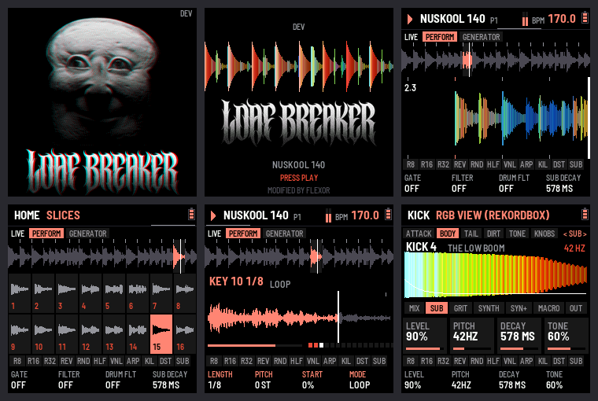
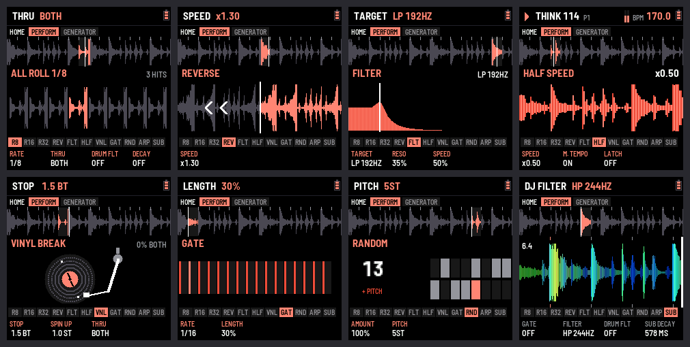
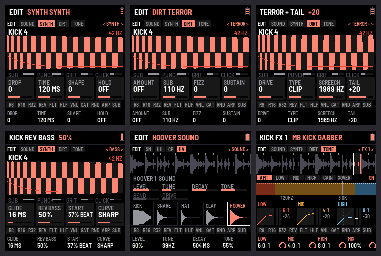
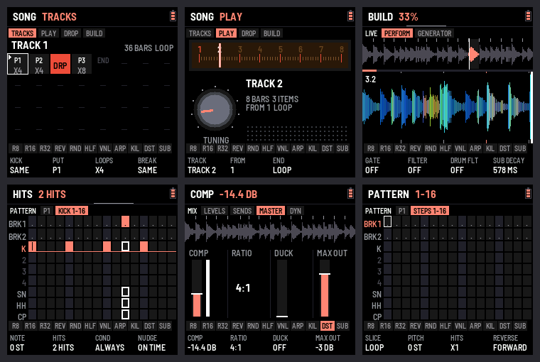

<p align="center">
<picture>
<source media="(prefers-color-scheme: light)" srcset="docs/img/banner-light.png">

</picture>
</p>

<h1 align="center">LOAF BREAKER</h1>
<p align="center"><b>A hardcore kick synthesizer powerhouse and a breakbeat chopper for the M-VAVE FM-1.</b><br>HARDCORE - GABBER - BREAKCORE - TERROR - SPEEDCORE</p>

<p align="center">
<a href="https://flexor-r.github.io/loaf-breaker/"><b>Site</b></a> ·
<a href="https://flexor-r.github.io/loaf-breaker/emu/">Try it in the browser</a> ·
<a href="https://flexor-r.github.io/loaf-breaker/install/">Install</a> ·
<a href="https://flexor-r.github.io/loaf-breaker/manual/#start-in-five-minutes"><b>Start in five minutes</b></a> ·
<a href="https://flexor-r.github.io/loaf-breaker/manual/">Manual</a> ·
<a href="../../releases">Releases</a>
</p>

LOAF BREAKER is FLEXOR's firmware for the [M-VAVE FM-1](https://www.m-vave.com/), built on
**[CHOPPAH](https://github.com/profikid/fm1-break-choppah)**, Laurens Profittlich's Amen chopper. It keeps CHOPPAH's
heart (a break cut into sixteen slices on the white keys, effect pads on the black keys, a generator, a master effects
chain, patterns: 64 of them here) and drives it into hardcore and breakcore:

- **The kick first.** Its own menu, its own synth (pitch drop, hold, rumble, tune), **DISTO**, **SCREAM** and
  **DISTO +**, a **GLIDE** between notes and the rawstyle **REVERSE BASS**, its own EQ and FX (**MAGIC EQ**, **MAGIC MBC**),
  ten memories, a note on every step, and its real sound drawn live on screen. The **KICK LAB**: a CLEAN tail (one
  note from the hit to the end, no "talking" distortion), its NOTE, the pitch drop's CURVE, END, a closing TAIL
  FILTER and DRIVE, **STACK** (another kick's attack on this one's tail), MUTATE and A/B.
- **A sequencer for live.** Kick over 16, 32 or 64 steps; per step **NOTE, HITS, COND** (chance, 1:2, 2:2) and
  **NUDGE**; **ARP: sixteen effects over everything** on the white keys (the OVERLAY page).
- **Tracks and drops.** Patterns in order with loops and per-item breaks, a radio-style PLAY, builds that don't sound
  alike (snare or kick rolls, stutter, sweeps, a gap, the **tempo rising** to the drop).
- **A mix that holds.** COMP, DUCK, MAX OUT, rolls on the break or the kick. Kicks and drums only: no melody (gone in 0.209).
- **A screen that moves.** The mix scrolling as a CDJ in rekordbox colours, the track's progress and "DROP IN 4",
  beat-lit tempo, kick flashes, screen effects (CRT, VHS, GRAIN, RGB, SHAKE, STROBE, 8-BIT), a glitched start-up.

Built on [fm1-base](https://github.com/charlesvestal/fm1-base) (MPL-2.0). No Bluetooth: MIDI over USB and the TRS jack.









- **The manual**: [online](https://flexor-r.github.io/loaf-breaker/manual/), or [app/docs/MANUAL.md](app/docs/MANUAL.md)
- **Download the firmware**: [releases](../../releases) (`loaf-breaker-X.YY.fwsc`), each release also carries the
  site (emulator, installer, manual) as `loaf-breaker-site-X.YY.zip`.
- **Install**: fm1-base's web installer (Chrome or Edge, the FM-1 plugged in), or
  `python3 base/tools/fm1_install.py loaf-breaker-X.YY.fwsc`

Installing is at your own risk; the installer can put M-VAVE's own firmware back, and an FM-1 that fails to start
twice comes up in a safe mode the installer can still reach. If your FM-1 runs M-VAVE's FM1 Open firmware, restore
M-VAVE's original firmware first ([docs/FLASHING.md](docs/FLASHING.md)).

**Status: 0.2xx beta, on its way to 1.0.** Every push to the `loaf` branch is a release (`loaf-vX.YY`). LOAF BREAKER has no Bluetooth.

## Panel

Each button is a domain, named on the screen: LIVE (HOME), SOUNDS (EDIT), PATTERN (SEQ), SONG (ENV), MIX (LFO), EFFECTS (FX),
SYSTEM (GLO). The button again: the next part; SEL + a button: that domain's second function (tap SEL to see them all).

| Control | Does |
| --- | --- |
| White keys 1–16 | Slices: at the next snap point while playing, at once while stopped. **Hold to loop**: K1–K4 set that key's loop (length, pitch, start, mode). **Key held + FX**: that slice's own effect |
| Black keys | Pads, while held, on a layout (EXPERT: ARP › BLACK KEYS). CHOPPAH's, a new FM-1's (BEGINNER keeps the layout EXPERT left): **R8 · R16 · R32** rolls (K2 THRU: the break, the kick or both; SEL + a roll pad: a kick roll for that press) · **REV** reverse · **FRZ** freeze · **HLF** half speed · **VNL** vinyl break · **GAT** gate · **RND** random (REV, FRZ, HLF, GAT, RND each with a LATCH: a press on, the next off) · **FLT** filter throw (K4 THRU: the break, the drums or both) · **DUB** dub echo throw. FLEXOR LAYOUT: R8 R16 R32 RND HLF FLT, **ARP** an overlay effect, VNL, **KIL** the sequencer's kicks quiet while held (or latched), **DST** the kick's DISTO off / on (its amount untouched), **SUB** SUB DRIVE. CUSTOM: any of them on any key. K1–K4 tune the pad held |
| PLAY | Play / stop · HOME + PLAY: back to bar 1 |
| SELECT | Tempo · on the pages with tabs, the tabs at the top (the KICK menu's sections, EFFECTS' slots, SONG's tabs) and ALGORITHM those below · **SEL + SELECT**: the drums' filter (DRUM FLT) on any page |
| SEL | **Live: SEL + K1–K4 change the kick while it plays, on any page; SEL twice locks SEL down (lit), both hands free; once more frees it.** **Tapped alone**: the shortcuts card, those that work everywhere and this page's own · **SEL ×2**: locked down, lit, for the combinations one-handed (press again: free); held or locked, the foot shows SEL + K1–K4's functions and values · **SEL + K1–K4**: four live functions you assign on EDIT › KNOBS (or all four at once on ASSIGN with a style: TERROR, EARLY NEXT GEN, HARDCORE …, or one of your own PRESET 1–4, their values too: SAVE on it stores them), each kick its own (PITCH DROP, RUMBLE, PUNCH, DRIVE, DISTO, SCREAM, DISTO +, its TYPE, SCREECH, TAIL…) · **SEL + REC** (on FX): the effect under your hands back to its start (again within 4 s: undo) · **SEL + ENV**: the drop · **SEL + ALGORITHM** the break (where ALGORITHM is already the break, HOME, BREAK, SONG, MIX, OVERLAY: BREAK TIME NORMAL / HALF), **SEL + PRESETS** the pattern (on HOME, PATTERN, MIX, OVERLAY, SYSTEM's MIDI / FX SET / RESET: the kick, KICK 1–20) · **SEL + SEQ** copy, then paste the pattern · **SEL + ARP** in the KICK menu: copy the kick, then paste it on another (a drum's page: the drum) · **SEL + SAVE** undo · SEL alone: every combination on the strip |
| HOME | The main page: PERFORM and GENERATOR, with the **CDJ view** (the mix scrolling in, rekordbox's RGB colours, the playhead at the right edge); HOME held: the slices; **SETTINGS**: VIEW (waveform or slices), WAVE TYPE (rekordbox or Serato), WAVE ZOOM, BREAK TIME (the break at half the tempo) |
| EDIT | **SOUNDS**. The **KICK menu**, by the kick's anatomy: ATTACK (PRESET: the built-in kicks, where it opens; CLICK, PUNCH, STACK: another kick's attack), BODY (MIX, SUB, GRIT, SYNTH: DROP, HOLD, RUMBLE, ASYM, TUNE…, MACRO, OUT), TAIL (a CLEAN tail, its NOTE, CURVE, END, FILTER; BASS: GLIDE, the rawstyle REVERSE BASS; MORPH), DIRT (DISTO, SCREAM, DISTO +), FX1 and FX2 (its two FX slots, each kick its own), MORE (KNOBS: what SEL + K1–K4 turn, ASSIGN, TOOLS: MUTATE, A/B, EDIT VIEW, DRUM VIEW ZOOM; its EQ, EQ B and EQ S); twenty kicks, KICK 1–20 (PRESETS, on the KICK menu's pages; in its FX section PRESETS the effect, SEL + PRESETS the kick; SEL + PRESETS elsewhere a knob's function, a style), each naming the built-in it came from; the kick drawn in RGB as rekordbox or Serato do (GLO EFFECTS K3), whole or only the part edited (K4) (EDIT held: WAVE, CLASSIC); SELECT: the next section, ALGORITHM: the next part; EDIT again: the next sound (KICK, SNARE, HAT, CLAP); EDIT held: the classic view. **SEL + EDIT**: the next source, DRUMS (snare, hat, clap: EDIT again the next), BREAK (pitch, grain, snap, level; ALGORITHM the break) |
| SEQ | **PATTERN** (SELECT the lane, ALGORITHM its bar on a long lane (kick of 64: 1–4); SEQ again: HOME): the sequencer: the break's steps and the drum lanes, the kick over 16, 32 or 64 steps. **A step held**: K1 NOTE, K2 HITS (1–4 taps in the step), K3 COND (chance, 1:2, 2:2, FILL, NOT FILL), K4 NUDGE. Playing, the keys follow the bar playing. **SEQ held** + key 1–4: copy the bar there; + K1: shift the lane a step; + REC: clear the drums; then SEQ again: clear the pattern. **REC** on a drum lane: tap it in · SELECT past the lanes: **GROOVE** (SWING) |
| ENV | **SONG** (SELECT its tabs; ENV again: HOME): TRACKS (patterns, loops, drops and each item's own break and kick; a DROP its build's kick (K1), STUTTER (K3) and what its GAP keeps (K4: the break, the drums, the echoes); ENV held: a space after the item, or the space taken out), PLAY (a radio: tune a track, press PLAY), DROP, BUILD (the build before a drop: style, sweep, riser, a gap; PRESETS: the tempo rising to the drop) |
| LFO | **MIX** (SELECT its tabs; LFO again: HOME): LEVELS (break, kick, drums; ARP: its effects on the BREAK, the KICK or THRU, everything), SENDS (the FX fader, the drums around the FX (the default) or through it, ARP the same), MASTER (COMP, RATIO, DUCK, MAX OUT), DYN (the compressor's and the ducker's timing) · **LFO held + K1–K4**: the four levels on any page |
| FX | **EFFECTS** (SELECT the slot, ALGORITHM its part MAIN / MORE / MOD; FX again: HOME): the master FX chain: four slots (FILTER, CRUNCH, DRIVE, PUNCH, FLANGER, RING MOD, TREMOLO, REVERB, DELAY, EQ, TAPE, MB COMP, CLIP); each effect remembers its settings when you change it and back; FLEXOR's presets MAGIC EQ and MAGIC MBC after CLIP (BEGINNER: two slots, a short list) |
| ARP | **OVERLAY** (EXPERT: SELECT its two tabs; ARP again: HOME): sixteen effects over everything, one a white key (held, or LATCH: on and off); K1 the amount, K2 the rate, K3 the sweep, K4 LATCH · SEL + ARP: PATTERN › GROOVE (SWING) |
| GLO | **SYSTEM** (SELECT its parts; GLO again: HOME): MIDI clock in and out (USB, TRS), and in EXPERT the METER; SETUP: 24 skins, MODE (TUTORIAL: 31 guided steps, the buttons to press blinking; BEGINNER: the essentials (the KICK three pages, KICK, SHAPE and MIX; two FX slots and a short list; a new FM-1 asks for its mode first); EXPERT: all of it), AUTO SAVE; EFFECTS: the screen effects, several at once (CRT, VHS, GRAIN, RGB, SHAKE, STROBE, 8-BIT), (the waves' colours, WAVE ZOOM and BREAK TIME: HOME › SETTINGS; EDIT VIEW and DRUM VIEW ZOOM: KICK › KNOBS › TOOLS); FX SET: their settings; RESET: one part at a time, or EVERYTHING (RESET ALL, 15 turns) |
| SAVE | Keep the settings, the patterns, the tracks and the steps |

## Breaks

LOAF BREAKER has 9 breaks on ALGORITHM, 2 bars each: NUSKOOL 140, AMEN20 164, AMEN19 172,
UPDOWN 165, AMEN15 174, JUNGLE 175, THINK 114, APACHE 115 and THEWORM 110. [`breaks/breaks.txt`](breaks/breaks.txt) marks with `*` the ones
built in (the bank has 400 KB); `./build.sh` builds them into `app/bank_data.h` (generated, git-ignored). The breaks
are built in: LOAF BREAKER does not load samples of your own.

## Building

```
scripts/bootstrap.sh    # once: fm1-base (submodule), JieLi toolchain, AC79 SDK files, Python packages
./build.sh test         # the engine's tests, plain cc, no toolchain needed
./build.sh              # app/build/loaf-breaker.fwsc (the build's files keep CHOPPAH's name) (macOS: the toolchain runs in Docker / OrbStack)
./build.sh --host       # the host simulator: app/build/host/loaf-breaker_host tests/scenarios/ui.txt OUTDIR
./build.sh --web        # the browser emulator (Emscripten)
./build.sh flash        # install over USB-MIDI (docs/FLASHING.md)
```

Clone with `--recursive` (fm1-base is a submodule in `base/`).

| Path | What |
| --- | --- |
| `app/` | The firmware: `app.c` (screens, controls, glue), `app.h`, `fm1.toml` (build and site settings) |
| `app/dsp/` | The engine, platform-free: `brk` (sequencer, generator, pads, voices), `brk_fx`, `adpcm`, `brk_synth`, `brk_bank.h` |
| `app/docs/`, `app/site/` | The manual and the site's front page |
| `tests/engine/` | Engine tests (plain cc), with WAV renders |
| `tests/scenarios/` | Host-simulator scripts: keys in, audio and screenshots out |
| `breaks/` | The recorded breaks (WAV) and `breaks.txt`, which of them go into the firmware |
| `tools/prep_breaks.py` | WAV → slices → IMA ADPCM bank (`--list breaks/breaks.txt`, as `./build.sh` runs it) |
| `docs/` | [PRD](docs/PRD.md), [flashing and recovery](docs/FLASHING.md), [the FM-1 Firmware Hub's submission](docs/hub/SUBMIT.md), [porting to other hardware](docs/PORTING.md) |

## Publishing

Every push to the `loaf` branch is a release (`.github/workflows/loaf.yml`): the engine tests, the firmware and
its size report, the host scenarios, then a GitHub release `loaf-vX.YY` with `loaf-breaker-X.YY.fwsc` and the site
built from the same commit (front page, installer, emulator, manual with its screenshots: `loaf-breaker-site-X.YY.zip`).
Past 0.99 the numbers go on, 0.100, 0.101…; the package itself says 0.99.N for fm1-base.

The manual's and the site's screenshots come from the host simulator: `./build.sh --host`, then
`sh tools/site_shots.sh` (into `app/docs/img`).

## Licence and credits

MPL-2.0 ([LICENSE](LICENSE)). LOAF BREAKER is built on [CHOPPAH](https://github.com/profikid/fm1-break-choppah) by
Laurens Profittlich, itself on [fm1-base](https://github.com/charlesvestal/fm1-base) and
[felucca-bsp](https://github.com/hugelton/felucca-bsp), from [Felucca](https://github.com/hugelton/Felucca) by Leo
Kuroshita (Hügelton Instruments).

M-VAVE and FM-1 are trademarks of their owners. LOAF BREAKER is not affiliated with M-VAVE, nor with CHOPPAH's author.
