# LOAF BREAKER

LOAF BREAKER is a hardcore firmware for the M-VAVE FM-1, built by FLEXOR on **CHOPPAH**, Laurens Profittlich's Amen
chopper. A break is cut into sixteen slices, one on each white key, and plays in time while you rearrange it, roll
it, reverse it, stop it like a tape and push it through effects; under it a kick made for terror, gabber and
crossbreed (DISTO, its own synth, its own effects, notes on every step), a sequencer of 16, 32 or 64 steps, tracks
with built-up drops, a snare, a hat and a clap, a compressor and a CDJ-style waveform of what leaves the mix. Kicks and
drums, nothing else: the melody (0.198–0.208) is gone since 0.209.

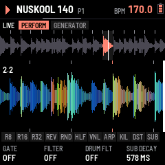

---

## Start in five minutes

LOAF BREAKER turns the M-VAVE FM-1 into a hardcore break machine: a breakbeat cut into 16 slices, a distorted kick
built from scratch, drums, effects and drops. You don't need the whole manual to start: these five steps are enough.
The FM-1 starts in **BEGINNER** mode (SYSTEM › SETUP: GLO, then SELECT; K1): the advanced pages stay hidden until you want them.

**Or let the FM-1 show you: the TUTORIAL.** A new FM-1 asks first, after its start screen: **TUTORIAL**, **BEGINNER**
or **EXPERT** (a knob moves the choice, PLAY takes it; white keys 1–3 too). SYSTEM › SETUP K3, turned left past
BEGINNER, starts the tutorial again. The header says one thing to do at a time, the button or the keys that do it blink, and
when it's done, "OK!" and the next: at once for a button (HOME, EDIT, SEQ, SAVE ..), five seconds later where there is
something to hear (an effect, a kick, the drop): 31 steps in nine lessons, THE
BREAK (HOME: the PERFORM menu, PLAY, the slices, ALGORITHM: another break), HOME (0.9.2: HOME again, GENERATOR; again,
SETTINGS; KNOB 1, the slices; HOME, PERFORM in slices; HOME held, the waveform again), EFFECTS (a black key; ARP, the OVERLAY page, two of its effects), THE PATTERN (SEQ: two kicks, a snare),
THE KICK (EDIT, PLAY to stop: stopped, white keys 1–4 play the kick, the snare, the hat and the clap; KNOB 1 a built-in
kick, key 1 to hear it; KNOB 2 its DISTO; EDIT again: SHAPE, KNOB 3 a longer tail; PRESETS: your ten kicks, each heard
on key 1), THE DRUMS (SELECT: the SNARE, KNOB 1 its presets, KNOB 2 its FX, heard on key 2), THE FX (PLAY again, FX,
PRESETS: an effect), THE DROP (SEL + ENV) and SAVE. Everything is real: you play the firmware itself. The page buttons a step doesn't ask for do nothing meanwhile ("FOLLOW THE STEP"; GLO still quits); off the step's page all the same, the header says how to get back there ("PRESS HOME: BACK TO THE BREAK"), that button blinking. **SEL + GLO** skips a step, **GLO** quits (SETUP K3 starts it
again where you left it; SAVE keeps where you are). An FM-1 already in use when it updates doesn't start it. AUTO SAVE (SYSTEM › SETUP K4) is off while the tutorial runs and comes on when it ends (or you quit it); choosing BEGINNER at the first start turns it on too.

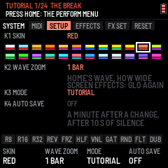

### 1. Press PLAY

The break plays with its kick at once (NUSKOOL 140 to start). **ALGORITHM** picks the next break (it changes on the next
bar), **SELECT** sets the tempo, **PRESETS** the pattern (P1–P64). PLAY again stops.

### 2. Play the white keys: the slices

The 16 white keys are the break's 16 slices. Tap one: that slice. **Hold one: it loops** until you let go, in time.
Play two or three in turn and you are already chopping.

### 3. Hold a black key: the effects

The black keys act while held and can be combined. A new FM-1 has CHOPPAH's, left to right: **R8 · R16 · R32** roll
the break, **REV** plays it backwards, **FRZ** freezes the slice playing, **HLF** halves the speed, **VNL** stops it like
a record, **GAT** gates it, **RND** shuffles the slices, **FLT** sweeps a filter, **DUB** throws it into an echo. While
one is held, K1–K4 tune it. In EXPERT, **ARP › BLACK KEYS** gives them another layout (FLEXOR LAYOUT: the ARP key, KIL,
DST, SUB) or your own.

### 4. EDIT: shape the kick

**EDIT** opens the kick, drawn large: what you hear, its pitch falling in amber. K1–K4 change the part shown;
**ALGORITHM** goes to the next part, **SELECT** to the next section (ATTACK, BODY, TAIL, DIRT, FX1, FX2, MORE: the tabs at the top), and **EDIT** again to the next sound (KICK, SNARE, HAT, CLAP, round). In EXPERT it opens on ATTACK's **PRESET**: KNOB 1 picks a built-in kick, 909 to DISTORTO. Each part
says in a few words what it is for. Try **DIRT › DISTO** (K1: the distortion) and **SYNTH › BASS** (K2: the
rawstyle reverse bass). **PRESETS** there picks one of the 10 kick memories: each keeps its own sound.

### 5. Build and drop

**SEL + ENV**: a build from the next bar, then the drop. Then write your own patterns on **SEQ** (white keys: the
steps of the lane shown; SELECT: the lane, ALGORITHM: its bar on a long lane) and chain them on **ENV** (TRACKS: patterns and drops one after another).

### Two buttons to remember

- **SEL**, tapped alone: the card of shortcuts, those that work everywhere and those of the page you are on.
  Twice quickly: SEL stays held (lit) for one-handed shortcuts; once more frees it.
- **SAVE**: keeps everything (or SYSTEM › SETUP: AUTO SAVE).

### Moving around (0.9.2)

On every page with tabs, **SELECT turns the tabs at the top** (EFFECTS' slots, SONG's TRACKS PLAY DROP BUILD, MIX's
LEVELS SENDS MASTER DYNAMICS, SYSTEM's parts, OVERLAY's two, the KICK menu's sections) and **ALGORITHM those below**
(an effect's MAIN MORE MOD, the kick's parts). **A page's button pressed again goes back to HOME**, the main page
(FX, ENV, LFO, GLO, ARP; EDIT keeps going round the sounds). The tempo is SELECT's on HOME.

### Playing live: SEL + K1–K4

**Hold SEL and turn K1–K4, on any page: the kick changes while it plays.** That is the FM-1's live shortcut, the one
to remember above all in EXPERT. Out of the box: **SEL + K1** DRIVE, **SEL + K2** SCREAM, **SEL + K3** SCREECH, **SEL +
K4** DISTO; their names and values show at the foot of the screen while SEL is held. Each kick (KICK 1–20) keeps its own
four, chosen in **EDIT › KNOBS** (the four knobs one by one, or a whole style at once on **ASSIGN**).

**SEL twice quickly locks it down: SEL stays lit** and counts as held, so both hands are free: K1–K4 move the kick, and
every SEL combination works with one hand. **SEL once more frees it** (the light goes out). Lock it before a set: the
four kick knobs are always under your fingers, whatever page is open.

When you know your way around: **SYSTEM › SETUP (GLO, then SELECT), K1 → EXPERT** shows every page (the kick's layers and their effects,
SCREAM and DISTO +, SYNTH +, CLEAN MORPH, each knob's settings…). The rest of this manual covers everything.

---

## Contents

1. Install
2. The screens
3. Playing
4. The pads
5. Patterns and the sequencer
6. The FX chain
7. SYSTEM (GLO): MIDI, setup, screen effects, reset
8. The drums: kick, snare, hat
9. The mixer
10. Pages and knobs
11. The control map
12. Saving
13. Troubleshooting

---

## 1. Install

**Try it first:** the emulator runs the same code in the browser, with sound, played with the mouse.

**Install:** open the install page in Chrome or Edge, connect the FM-1 by USB and press Install. While it writes,
the FM-1 shows LOAF BREAKER's picture, UPDATING and DO NOT UNPLUG, and the bar fills. When it is done, the page
throws confetti. If the FM-1 runs M-VAVE's FM1 Open firmware, put M-VAVE's original firmware back first (M-VAVE's workbench, *Restore original*), then
install LOAF BREAKER.

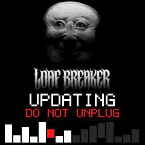

## 2. The screens

At power-on LOAF BREAKER shows its picture, then the start screen: the loaded break drops in slice by slice while a light
runs through the buttons, they all flash as it completes, and PLAY blinks green. After two
seconds, or at once on any key, the **slicer view** opens. PLAY on the start screen also starts the break.

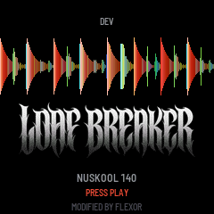

The slicer view, top to bottom:

- **Header:** play or stop, the break's name, the pattern (P1–P64; "P2>" while P2 waits for the loop's end), REC
  while recording, a level meter (left and right, what leaves after MASTER: amber from
  −8 dB, white near full scale), the tempo: lit white on each beat. The line under the header flashes on each kick
  and a tick under it walks the bar's four beats. The PLAY light blinks off on each kick, and during a build the
  next white key to light blinks, faster as the drop nears.
- **Tabs:** the page's domain (on SOUNDS, the source: KICK, DRUMS, BREAK), then its parts as tabs, the one
  you are on lit: the button again (or ALGORITHM) goes to the next. On SOUNDS and EFFECTS the part edited shows at the
  right, "< SUB FX >". Opening a page, or turning to another part, says the same in the header for a moment: the
  domain, then the part ("SYSTEM SETUP", "SOUNDS KICK DIRT DISTO", "EFFECTS SLOT 2 TREMOLO", "PATTERN H1"). The tabs sit right under the header on every
  page, tap tempo's too.
- **The break:** its waveform, the slice markers, the slice sounding lit, the playhead.
- **Slice blocks:** sixteen blocks, one per white key, each with its slice's waveform. The slice sounding is lit;
  a key held is outlined; a dot marks a key with a loop of its own (§3, key loops).
- **Pads:** the eleven black-key pads, lit while held.
- **Knobs:** the page's four knobs and their values; where the page knows how far a knob is turned (an FX slot, the
  MIXER's levels, the kick's classic view), an arc beside the value shows it.

### How it is organised (0.201)

Each button is a **domain**, named on the screen (the button keeps its print), in the order the sound travels:
sources, the pattern, the song, the mix, the effects, the system.

| Button | Domain | Its parts |
| --- | --- | --- |
| HOME | LIVE | PERFORM, GENERATOR, SETTINGS (K1 VIEW, K2 WAVE TYPE, K3 WAVE ZOOM, K4 BREAK TIME); HOME again: the next tab. HOME is the main page: FX, ENV, LFO, GLO or ARP pressed again come back to it, SELECT turning their tabs |
| EDIT | SOUNDS | Three sources, **SEL + EDIT** the next: **KICK** (its menu, by the kick's anatomy: ATTACK, BODY, TAIL, DIRT, FX1, FX2, MORE; SELECT its next section; EDIT again the next sound, EXPERT: SNARE, HAT, CLAP, then the KICK), **DRUMS** (SNARE, HAT, CLAP; EDIT again the next), **BREAK** (PITCH, GRAIN, SNAP, LEVEL; ALGORITHM the break) |
| SEQ | PATTERN | The lanes, **GROOVE** (SWING; also SEL + ARP) |
| ENV | SONG | TRACKS, PLAY, DROP, BUILD |
| LFO | MIX | LEVELS (BREAK, KICK, PERC, ARP), SENDS (FX, the drums' route, ARP), MASTER, DYNAMICS |
| FX | EFFECTS | The four slots: MAIN, MORE, MOD |
| GLO | SYSTEM | MIDI (EXPERT: K3 METER), SETUP (K1 SKIN, also PRESETS; K3 MODE, K4 AUTO SAVE), EFFECTS (the screen's), FX SET, RESET |

The same gestures everywhere: **the button again** is the next part; **ALGORITHM** the element in the part (a slot, a
lane, a drum's part; where there is nothing to pick, the break); **PRESETS** the pattern, but on SOUNDS the source's
memory (KICK 1–20, a drum's sound); **SEL + a button** that domain's second function, one
table (tap SEL alone to see it):

| SEL + | Does | SEL + | Does |
| --- | --- | --- | --- |
| EDIT | The next source | REC | Clear (the lane on SEQ, the pattern elsewhere) |
| SEQ | Copy the pattern; on another, paste | SAVE | Undo |
| ENV | The build, then the drop | ALGORITHM | The break |
| ARP | PATTERN's GROOVE | SELECT | The drums' filter |

(0.200 had the earlier layout: its release stays on GitHub, to go back to it.)

**The rules.** ALGORITHM picks what you edit on the page (an FX slot, a drum's part, a SEQ lane, SYSTEM's part); on HOME (both its parts) and the MIXER, where there is nothing to pick, it is the break. PRESETS picks what goes
in (an effect, a kick, a snare or hat sound); elsewhere it is the pattern. **SEQ is where everything is sequenced**
(the break's steps and the kick, snare and hat lanes), **EDIT where the drums' sounds are made** (kick, snare, hat);
the white keys play slices everywhere but SEQ and ENV (tracks). **ARP opens the OVERLAY page** (§5). **SEL + ALGORITHM is the break and SEL +
PRESETS the pattern on every page.** **Where ALGORITHM alone is already the break** (HOME, SOUNDS › BREAK, SONG's PLAY / DROP / BUILD, MIX, OVERLAY), **SEL + ALGORITHM is BREAK TIME** (right HALF, left NORMAL), **and SEL + PRESETS the kick** on HOME, PATTERN, MIX, OVERLAY and SYSTEM's MIDI, FX SET, RESET (0.9.26, FLEXOR). A page's button pressed again is its next part. **Press SEL** alone and the strip
shows a card: above, the four SEL combinations that work on any page; below, this page's own shortcuts (on HOME and
the pages without any: what SEL + K1–K4 turn). SEL again, or any other button, key or knob, closes it. The control map (§11) shows all of it at once.

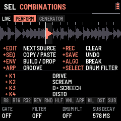

## 3. Playing

| Control | Does |
| --- | --- |
| PLAY | Play / stop. HOME + PLAY: back to bar 1 |
| White keys | Slices 1–16. Playing: at the next snap point (SOUNDS › BREAK, SNAP: 1 slice, an 8th on the 2-bar breaks, by default; OFF, 1/8 … 4 slices). Stopped: at once. Held: the key loops (below), playing or stopped |
| SELECT | Tempo, 1 BPM a detent · **SEL + SELECT**, on any page: the drums' filter (DRUM FLT, as HOME's K3) |
| ENV | **TRACK**: tracks of patterns and drops, playing them, the drop's settings (below) |
| SEL (pressed alone) | The combinations card: every SEL combination on the strip. SEL used with something else (SEL + a knob, SEL + ALGORITHM, SEL + REC…) does that instead |
| SEL + ALGORITHM | The break, from any page; **BREAK TIME** (right HALF, left NORMAL) where ALGORITHM alone is already the break: HOME, SOUNDS › BREAK, SONG's PLAY / DROP / BUILD, MIX, OVERLAY (0.9.26) |
| SEL + PRESETS | The pattern, from any page; **the kick** (KICK 1–20) on HOME, PATTERN (SEQ, GROOVE), MIX, OVERLAY and SYSTEM's MIDI, FX SET, RESET; in the KICK menu the KICK FX effect, a knob's function, a style (0.9.26) |
| SEL + ARP | PATTERN › GROOVE; **in the KICK menu: copy the kick, then, on another kick (PRESETS), paste it** (its sound, LAB, KNOBS and FX; its volume kept); on a drum's page the same for that drum's memories (0.9.26) |
| SEL + SAVE | **Undo** the last pattern wipe (SEL + REC, a drum lane's FILL, CLR / 4X4 or COPY); again: redo |
| OCT− / OCT+ | Pitch in semitones (hold to go faster). Both: back to 0 |
| PRESETS | The pattern, P1–P64 (§5); while playing the new one starts at the end of the loop |
| SEQ · REC | The sequencer; recording the keys into the pattern (§5). SEL + REC: clear the pattern (SEL + SAVE takes it back) |
| MIDI notes | Notes 48–63 (C3–D#4) play slices 1–16, held like the white keys; 36 the kick, 38 the snare, 42 / 44 / 46 the hat (§8); any channel |
| ALGORITHM | (HOME, MIXER; SEL held: any page) The next or previous break: its name shows at once (amber in the header) and, while playing, it comes in at the next bar (the old one goes quiet for the bar's last 16th meanwhile); stopped, at once. NUSKOOL 140, AMEN20 164, AMEN19 172, UPDOWN 165, AMEN15 174, JUNGLE 175, THINK 114 (Lyn Collins), APACHE 115 (Incredible Bongo Band), THEWORM 110 (Jimmy McGriff) (the Amens: The Winstons, cut by Cyberworm): 2 bars each, played at the tempo you set |
| MASTER | Volume |

### Where things are

- **HOME**: playing, the main page. PERFORM, GENERATOR and SETTINGS (HOME again: the next tab), the CDJ waveform on the
  first two; **SEL + PRESETS** there changes the kick (KICK 1–20, 0.9.26). **SETTINGS** (0.9.2): K1 **VIEW** (WAVEFORM or SLICES: what PERFORM and GENERATOR show; HOME held still flips
  it), K2 **WAVE TYPE** (REKORDBOX or SERATO colours), K3 **WAVE ZOOM** (how much of the past the wave holds), K4 **BREAK
  TIME** (NORMAL, or HALF: the break at half the tempo, at its own speed, its steps every other 16th, while the kick,
  the drums and the clock stay at the tempo: a 115 break under a 230 kick); SELECT stays the tempo. (0.9.25: these four
  are only here; SYSTEM no longer shows them.)
- **EDIT**: the **KICK menu**. Its picture: the kick's hit over a quarter of a second, its wave large (the cycles
  stretching as its pitch falls, squared off where it is driven), its level behind, the SUB's pitch falling in amber,
  its memory (KICK 1–20), what the part is for in a few words ("FOLD DISTORTION") and its note; under it the part's four knobs as cards, their values large. **SELECT**: the
  next section (**EDIT again**: the next sound, SNARE, HAT, CLAP, then the KICK), the kick's anatomy from its hit to its end: **ATTACK** (PRESET: K1 the built-in kicks, the part the menu opens on; CLICK, PUNCH, STACK), **BODY** (MIX, SUB, GRIT,
  SYNTH, SYNTH +, MACRO, OUT; the menu opens here), **TAIL** (TAIL, TAIL +, BASS, MORPH), **DIRT** (DISTO, DISTO +,
  SCREAM, the layers' effects), **FX1** and **FX2** (its two FX slots, each a section of its own since 0.9.29: ALGORITHM goes through the effect's parts, MAIN, MORE, MOD or the MB COMP's), **MORE** (KNOBS until 0.9.28: KNOBS, ASSIGN, K1–K4, TOOLS, then EQ B and EQ S, its EQ's bands and shape);
  **ALGORITHM**: the next part in it (each section remembers where you were). The section's parts are a bar of tabs at
  the foot of the picture, the whole width, the one open lit (BEGINNER: those it passes over dimmed; short names
  there: SYN+ for SYNTH +, D+ for DISTO +, S FX .. C FX for the layers' effects). **MORE** puts the live knobs on the kick's picture: its first part, KNOBS, has K1–K4 turn what SEL + K1–K4
  turn (DRIVE, SCREAM, D+ SCREECH, DISTO to start: their first setting, their value large), so you hear and see the
  kick as you set them; then **K1 SET .. K4 SET**, each knob's function with all its settings (DISTO:
  AMOUNT, SUB, FIZZ, SUSTAIN; MORPH: AMOUNT, TO KICK…), the function's name by the kick's (KICK 4  K4 DISTO). They
  are the kick playing's (PRESETS on KNOBS: KICK 1–20, each its own). **On K1 SET .. K4 SET, SEL + PRESETS gives that knob
  another function** (0.9.26: PRESETS alone changes the kick, on every page of the KICK menu) (the DISTO and SCREAM, DRIVE, DECAY, REV BASS, GLIDE, CLEAN SUB, MORPH and the rest), for
  the kick playing. **The picture has three views, EDIT held (half a second) the next:** **RGB** (to start: the
  kick's hit over half a second as rekordbox draws a track, each instant as tall as it is loud, its lows red, its mids
  green, its highs blue: a distorted kick white at the hit, orange in its body, red as its tail darkens, a SCREAM
  blue-green; the pitch falling in white; GLO EFFECTS K3: SERATO's colours instead), **WAVE** (its wave over its level, a quarter of a second, the pitch in
  amber) and **CLASSIC** (the part's knobs as bars, the layers' levels, the five drums' shapes, the break's wave
  above); the part stays where it is. **Stopped**, anywhere in the KICK menu (the big view, the
  classic view, its EQ and FX) and on the other drums' pages (big or classic), **white keys 1–4 play the KICK, SNARE,
  HAT, CLAP** once each, to hear them (the number on each drum's card; on the big views the strip names the
  drum played); playing, the keys play slices as ever. **A built-in kick on the kick selected:**
  **OUT** (BODY's last part), **K4 PRESET**: 909, TECHNO, EARLY HC, ROTTERDAM, INDUSTRIAL, DISTORTO, on the kick
  selected (PRESETS: KICK 1–20), its volume, steps and DISTO and SCREAM kept. **A kick copied onto another:** K4 PRESET past
  them, **COPY K1 … COPY K10**: that memory's kick, its SYNTH and its knobs (KNOBS, CLEAN SUB, BASS, MORPH) onto the
  kick selected, its volume kept (pick the kick to fill with PRESETS, then the one to copy with K4). Quicker (0.9.26),
  anywhere in the KICK menu: **SEL + ARP** copies the kick (COPIED KICK n), PRESETS to another, **SEL + ARP** again pastes
  it there whole, its FX section too (PASTED KICK a > b); on a drum's page the same copies the drum's sound onto another
  of its memories. On the KICK menu, **SELECT** goes through the tabs at the top (its sections: ATTACK, BODY, TAIL, DIRT, TONE,
  KNOBS) and **ALGORITHM** through those at the bottom (the section's parts) (0.264). **SEL + EDIT** opens the drums; there,
  SELECT goes from drum to drum (SNARE, HAT, CLAP, and round; BEGINNER: the KICK too), each in a big view of its own: its hit drawn large over its level, its decay
  marked in amber, its memory and tune, the four drums along the bottom (stopped: keys 1–4 play them), the part's
  knobs as cards (ALGORITHM: SOUND or SHAPE, PRESETS its memories). SELECT is not the tempo there. **SEL + EDIT** opens
  the drums in the view the kick has, and **EDIT held** goes round the same three views from either page (RGB, its
  colours rekordbox's or SERATO's as GLO EFFECTS K3 sets them, WAVE, CLASSIC): one view for the kick and the drums
  alike.

  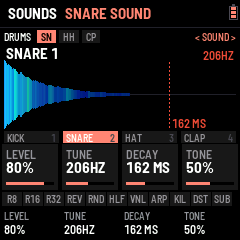
  - **SOUND**: MIX, SUB, PUNCH, GRIT, CLICK, OUT.
  - **SYNTH**: SYNTH, SYNTH +, BASS, **CLEAN MORPH** (K1 CLEAN SUB, K2 MORPH, K3 TO KICK: the kick's own, no knob
    needed), MACRO.
  - **DIRT**: DISTO, DISTO + (DRIVE, TYPE, SCREECH, TAIL), SCREAM, then each layer's effect.
    (DISTO, DISTO + and SCREAM were called TERROR, TERROR + and TERROR 2 before 0.191: names a newcomer reads.)
  - **FX1**, **FX2** (FX until 0.9.28, TONE until 0.9.1): its two FX slots, a section each: ALGORITHM the effect's parts
    (MAIN, MORE, MOD), as on the FX page. Its EQ (EQ B, EQ S) is in **MORE**, after TOOLS.
  The DISTO and SCREAM's settings are the kick's own: they go with its memory. **SEL + EDIT**: the next source, DRUMS
  (SNARE, HAT, CLAP; EDIT again the next), then BREAK, then the kick.
  The kick's **SYNTH** section:
  - **SYNTH**: DROP (how far above its note the SUB starts its pitch drop: a soft thud .. a laser boom), TIME (how long
    the drop takes, 30–480 ms), SHAPE (the SUB's wave: a clean sine .. squared off, harder), HOLD (the SUB held at full
    before it decays, up to 250 ms: the long gabber "bwoom"; left: a shorter one).
  - **SYNTH +**: RUMBLE (the kick low-passed into a feedback line under it: the rolling hardcore rumble between kicks),
    LENGTH (the rumble's echo, 23–93 ms), ASYM (an uneven drive: even harmonics, warmer and harder), TUNE (the whole kick,
    −12 .. +12 semitones).
  - **BASS**: **GLIDE** (the kick's pitch sliding from one step's note to the next, 0–400 ms: give the kick's steps
    notes in SEQ and it slides between them), **REV BASS** (the rawstyle reverse bass: the kick's sub at its note
    swelling up between two kicks, cut as the next one hits; it goes through the kick's drive and DISTO), **START**
    (where in the beat it begins, 1/8 to 5/8), **CURVE** (how it swells: SLOW, SOFT, SHARP, SNAP).
  At 0 each sounds as the kick always did. They go with its memory (KICK 1–20); its PRESET puts them back to 0.
- **LFO** (MIX): LEVELS, SENDS, MASTER (K1 COMP, K2 its RATIO, K3 DUCK, K4 MAX OUT; COMP's reduction metered),
  DYNAMICS (COMP's ATTACK and RELEASE, DUCK's RELEASE, DUCKS: the break, or the break and the drums).
- **ENV**: the song. TRACKS, PLAY, DROP, BUILD. (What SEL + each knob does: EDIT › KNOBS; RESET: GLO.)
- **GLO** (SYSTEM): MIDI (EXPERT: the METER), SETUP (SKIN, MODE, AUTO SAVE: K1, K3, K4, top to bottom; PRESETS turns the skin too; WAVE ZOOM is HOME › SETTINGS since 0.9.2), EFFECTS (several at once, keys 1–7; each effect's card a small picture with that effect done to it, lit when on, since 0.9.30; the waves' colours are HOME › SETTINGS' WAVE TYPE since 0.9.25; EDIT VIEW and DRUM VIEW ZOOM are KICK › MORE › TOOLS since 0.9.29), FX SET, RESET.
  The break's PITCH, GRAIN and SNAP are SOUNDS › BREAK; SWING is PATTERN › GROOVE.

### The CDJ view (HOME)

**PERFORM and GENERATOR show what leaves the mix** (the break, the kick, the drums, the effects; before MASTER)
scrolling in from the right, the playhead at the right edge, as a track on a CDJ. Each column is coloured as
rekordbox's RGB waveform: the lows red, the mids green, the highs blue, mixed (a kick reads red to orange, a snare
green to cyan, the hats blue), as tall as its peak. 4 beats fill the screen; the beats are ticked top and bottom (the
bar's first lit) and the bar and beat counted top left. While a track plays, a line along the top shows how far
along it is, and "DROP IN 4" counts the bars to its next DROP. **Hold HOME** (a third of a second) for the slice blocks
instead, hold it again for the waveform; neither moves to HOME's next part.

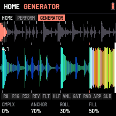 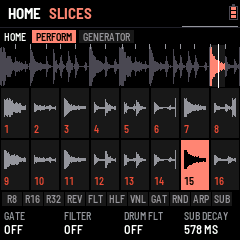

### Tracks and drops (ENV)

**ENV** opens TRACK; **SELECT** goes through its tabs: TRACKS, PLAY, DROP, BUILD (0.9.2: ALGORITHM still the items on
TRACKS); **ENV again** goes back to HOME (ENV held on TRACKS: a space after the item, as before). The tempo is SELECT's
on HOME and the other pages (the metronome and tap tempo are gone).

- **TRACKS**: eight tracks (**PRESETS** picks one), each up to 32 items in four rows of eight: a pattern (P1–P64)
  played for its loops (×1–×16), a **DROP** (the build, then the drop into the pattern after it), and its END.
  **ALGORITHM** the item, **K1** its **kick**: SAME (the one playing goes on) or KICK 1–20, taken as the item's pattern
  comes in (playing from it: at once; a DROP into it: with the drop; its cell shows it, "K7"); on a DROP, the kick its
  **build** plays (its kick roll, say), the one before back at the drop ("DRP K5"), **K2** what it is: END, EMPTY, DROP, P1–P64 (DROP just left of P1; EMPTY, left of DROP, empties the case and keeps its place: ENV held on it,
or K2 left once more, deletes it, the rest moving up; then K2 left does nothing until the knob has rested 0.7 s, so a
hard turn deletes one item, not the ones moving into its place, 0.9.26),
  **K3** its loops (on a DROP: **STUTTER**, OFF / ON: its build rolls the break, 8ths, 16ths, then 32nds, over BUILD's
  style; the item shows "DRP S"; 0.9.26), **K4** its **break** (on a DROP: **GAP KEEPS**, what plays in the silence
  before the drop, BUILD's K4 GAP its length: NOTHING, as before; BREAK, the break on alone; DRUMS, the kick and the
  drums (the build's roll); ECHOES, the sources quiet and the FX's reverb and delay ringing on; whatever it keeps,
  heard without the build's filter and riser; the item shows B, D or E; 0.9.26): SAME (the one playing goes on) or one of the bank's, in with the item
  (swapped at the bar's end, as ALGORITHM does; a cell with its own break shows it, "X4 B3"; a DROP into it brings
  it in, in DROP BREAK's place). What the track does at its end (LOOP, STOP, HOLD) is on **PLAY**'s K3.
  ALGORITHM moves along the items (the break stays as it is: SEL + ALGORITHM changes it). A
  **white key** puts its pattern at the item and moves to the next one. **ENV held** (0.45 s) makes room: the items after the one edited move one place right and an empty item (a + in an outline) opens after it, the one
  edited staying where it is; the cursor goes onto it, for a white key (a pattern) or **K2** (a DROP; K2 left: the
  space gone again). An empty item left is played past. **ENV held on an empty item** takes it out: the items on
  its sides close up, the cursor on the one before. ENV let go quickly: the next part, as ever.
  **SEL + PLAY** makes the item edited the one the track starts from (a flag at its corner, "FROM 2" at the top; again
  on it: from the first again); it is the track's own and saved with it. **PLAY** on TRACKS plays the track from there
  and stays on TRACKS (PLAY again stops it).
- **PLAY**: a radio. **K1** tunes it: the needle glides along the dial to the track (1–8, the ones with something in
  them lit), the big knob turns with it; the station shows the track's length, its items, where it starts and what it
  does at its end. **K2** the item it starts from (the same as TRACKS' SEL + PLAY, each track its own). **PLAY** (or white keys 1–8: that track) plays it from
  bar 1 and goes back to HOME; the header shows T1 … T8. Each pattern comes in at the end of the last loop of the one
  before; a DROP's build starts at the next bar. **SEL + ENV** while a track plays drops into its next pattern and the
  track goes on from there. PLAY again stops it.
- **DROP**: **K1** the build: NONE (the bar playing ends in the drop), 1, 2, 4 or 8 bars; **K2** the pattern a SEL + ENV
  drop brings in (NEXT, or P1–P64); **K3** the break it brings in (SAME, or one of the bank's); **K4** the crash's
  level; **PRESETS: BUILD KICK**, the kick the build plays (SAME, or KICK 1–20: for its kick roll, say), the one
  before back at the drop (a track's DROP item: its own, TRACKS K1).
- **BUILD**: how the build before a drop sounds, so drops don't all sound alike. **K1 STYLE**: SNARE ROLL (the
  snare speeding up, as ever), KICK ROLL (the kick doing it), KICK+SNARE (the two in turn), STUTTER (the drums out, the
  break itself rolled in 8ths, 16ths then 32nds), SWEEP ONLY (the drums play on, only the filter and the noise build),
  RANDOM (each build picks one). **K2 SWEEP**: HIGH-PASS (as ever), LOW-PASS (closing down to ~400 Hz), NONE, RANDOM.
  **K3 RISER**: the rising noise, OFF to 200 % (100 %: as it was). **K4 GAP**: silence just before the drop (none, a
  16th, an 8th, a beat, half a bar), so the drop hits out of nothing. **PRESETS: TEMPO RISE**, OFF to +30 %: the
  tempo climbs with the build and drops back to yours at the drop (not while following a MIDI clock).
- **The live knobs** (EDIT › KNOBS): what SEL + each knob does, on any page. On the KICK menu's KNOBS section,
  **ALGORITHM** goes to K1 SET .. K4 SET, and **PRESETS** there gives that knob its function: SCREAM, DISTO, D+ DRIVE, D+ TYPE, D+ SCREECH, D+ TAIL (DISTO +'s settings, one each),
  DRIVE (the kick's INTENSITY), DECAY, REV BASS, GLIDE, CLEAN SUB, MORPH, PITCH DROP, RUMBLE, PUNCH, DRUM FLT,
  HOLD or KICK FX. They start as K1 DRIVE, K2 SCREAM, K3 D+ SCREECH, K4 DISTO. K1–K4 then set the
  function's settings (K1 is what SEL + its knob turns). DUCK and COMP are not here: the MIXER (LFO) has them, MASTER and
  DYNAMICS.
  - **SCREAM**: AMOUNT, SUB (what stays clean under it, ~48–250 Hz), SCREAM (the mids it pushes, ~150 Hz–2.4 kHz),
    PUSH (how hard).
  - **DISTO**: AMOUNT, SUB, FIZZ (its top, darker or brighter), SUSTAIN (the fold dying with the kick, or a wall).
  - **DISTO +** (its settings on EDIT KICK too): DRIVE (the fold's gain, apart from AMOUNT's mix), TYPE (FOLD the
    scream, CLIP squared off, CRUSH in steps, RECT rectified: an octave up, hollow and metallic, TUBE uneven: warm
    and fat; since 0.255 HALF one side alone, pushed: dirty and hollow, SINE folded round a sine: it sings as DRIVE
    goes up, WRAP past the edge back in from the other side: digital and harsh, FUZZ all but a square: a thick buzz),
    SCREECH (a resonant band, ~500 Hz–5 kHz, the whistle; OFF to the left),
    TAIL (the distortion dying fast, or hanging on between kicks).
  - **DECAY**: the SUB's tail (HOME's K4 the same). (TUNE is no knob's: SYNTH +'s K4 has it; a knob given it
    before has its own function again.)
  - **REV BASS**: AMOUNT, START, CURVE (the kick's BASS part). **GLIDE**: its TIME.
  - **CLEAN SUB**: AMOUNT. A pure sine at the SUB's note (its drop, its tail) laid **after** all the distortion, the
    distorted kick's own lows (under ~90 Hz) taken out as much: the round, fat bass under the dirt, as new-school
    gabber and uptempo do.
  - **MORPH**: AMOUNT, TO KICK. The kick playing slides towards another of the ten memories: every level, pitch,
    decay, tone, DISTO and SYNTH setting in between (the effects and DISTO +'s TYPE the nearer one's). From a round
    kick to a saturated one over a build, back at the drop.
  - **PITCH DROP**: AMOUNT, TIME (SYNTH's DROP and TIME): how far and how fast the kick's pitch falls, a short "tok"
    or a long dive. **RUMBLE**: AMOUNT, TIME (SYNTH +'s): the tail rolling between kicks. **PUNCH**: the MACRO's PUNCH
    (level, sweep, click): the attack. **DRUM FLT**: the drums' filter (SEL + SELECT's), on a knob. **HOLD**: SYNTH's
    HOLD, the kick square for longer before it falls. **KICK FX**: FX 1 MIX, FX 2 MIX, the kick's own two FX slots
    more or less.
  - **ASSIGN** (STYLE until 0.9.1; KNOBS' last part, ALGORITHM back from KNOBS): **K1–K4** each give their own knob its function, one at a
    time (the cards show them); **SEL + PRESETS** turns through eight styles (PRESETS alone: the kick, 0.9.26), each giving the four at once (the kick
    playing's): **TERROR** (DRIVE, SCREAM, D+ SCREECH, DISTO, as they
    start), **EARLY NEXT GEN** (PITCH DROP, RUMBLE, PUNCH, DRUM FLT), **HARDCORE** (DRIVE, PUNCH, DECAY, DISTO), **NEW
    SCHOOL** (DRIVE, CLEAN SUB, D+ TYPE, DISTO), **RAWSTYLE** (REV BASS, GLIDE, PITCH DROP, D+ TAIL), **INDUSTRIAL** (T+
    SCREECH, D+ TYPE, DECAY, KICK FX), **FRENCHCORE** (DRIVE, DECAY, SCREAM, PITCH DROP), **LIVE BUILD** (DRUM FLT, MORPH,
    RUMBLE, HOLD): DRIVE always on K1, DISTO always on K4. The kick's picture shows the style ("PRESETS: EARLY NEXT GEN", CUSTOM once a knob is changed on its
    own); their settings stay where they are. Each card also shows its function's value by the knob's name, and its bar
    moves as SEL + that knob turns it (SEL twice: locked, both hands free).
    After LIVE BUILD (or back from TERROR), **PRESET 1–4** are yours: the four functions *and their values*, the same
    for every kick. An empty one ("PRESET 1 (EMPTY)") gives the knobs back as you had them before PRESETS turned;
    **SAVE** there stores them in it ("PRESET 1 STORED, SAVED", everything saved with it). A stored one gives the kick
    playing its four functions and puts their values where they were: any kick, KICK 1 as KICK 10. To change one: pick
    it, change the knobs (SEL + them, or K1–K4 their functions), SAVE again.
  Every one of them has its place on the KICK menu too, the kick's own with no knob given it: the DISTO and SCREAM and DISTO +
  (DIRT), DRIVE (SYNTH's MACRO, INTENSITY), DECAY (SOUND's SUB), REV BASS and GLIDE (SYNTH's BASS),
  CLEAN SUB and MORPH (SYNTH's CLEAN MORPH).
  **KNOB is the kick's own**: each kick memory (KICK 1–20) keeps its four functions and their settings (CLEAN SUB,
  REV BASS, GLIDE, MORPH and its target; the DISTO and SCREAM, TUNE and DECAY were already its own). Change kick (PRESETS on the KICK
  menu) and the knobs are that kick's; come back and they are as you left them. KNOB shows
  whose they are (KICK 4) at the bottom. RESET KNOB puts back the kick playing's.

**No saturation.** Whatever the effects and COMP do, a last guard holds every peak under full scale (-0.4 dB) by turning
it down at once, never clipping it square. And **MAX OUT** (the MIXER's MASTER, K4) sets how loud the output gets with MASTER
all the way up: -3 dB to start with (headroom for the FM-1's output and your speaker), right to 0 dB, left down to
-12 dB.

**SEL held a moment, or locked, shows the SEL + K1–K4 functions at the foot of the screen** (their names in amber, their values: what EDIT KICK › KNOBS gave them), back to the page's knobs when SEL goes up or is freed (0.258). **SEL ×2 (two quick clicks) locks it down**: SEL lights and counts as held, so every SEL combination works with one hand
(SEL + a knob, SELECT, PRESETS, ALGORITHM, ENV…); **SEL pressed again frees it**.

**SEL + ENV** (playing) asks for the drop (SEL ×3 no longer does: too easy by mistake): the build starts at the next bar, so the drop always lands on a bar line.

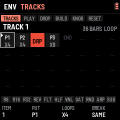 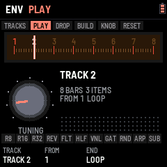 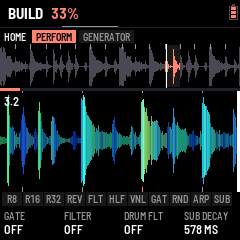

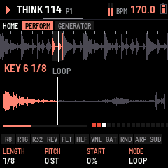

### Key loops

Hold a white key and it loops: a window that starts in its slice plays again and again in time, until you let go
(playing, the break carries on from there; stopped, it ends with the window). Held for a moment, the slice blocks
give way to **the key's view**: its window zoomed to the screen's width, the part this repeat has played lit (from
the right when it runs backwards), the playhead, the slice lines inside the window, this repeat's progress and a dot
for each repeat. A quick tap plays the slice once and keeps the blocks.

While the key is held, **K1–K4 set its loop**, for that key only (SAVE keeps them; a key with a loop of its own has a
dot on its block):

| Knob | Sets | Range |
| --- | --- | --- |
| K1 LENGTH | How long the window is, shown as music for this break | 1/8 of a slice … 16 slices (2-bar breaks: 1/64 … 2 BAR), with the jungle chops between: **3/32** after 1/16 (0.9.30), **3/16** after 1/8 and **3/8** after 1/4 (0.75, 1.5 and 3 slices; 0.9.29, from CHOPPAH 1.3.1) |
| K2 PITCH | The key's own pitch, on top of OCT | −12 … +12 semitones |
| K3 START | Where in the slice the window starts | 0 … 94 % of the slice |
| K4 MODE | LOOP · PING-PONG (every other repeat backwards) · REVERSE · ONE SHOT (once, then quiet while held) | |

SEL while a key is held puts its loop back to one slice, no pitch, from the start, LOOP. With several keys held the
last one pressed loops; let it go and the lowest still held takes over. Pads still work on top: REV turns the loop
round, ROLL and FREEZE take it over while held.

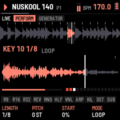

### Slice effects

Every slice can have an effect of its own, there whenever that slice plays: in the loop, from its key, in a roll.
Hold the key and press **FX**: K1–K4 turn from its loop to its slice's effect (FX again turns them back; the knobs
stay on the layer you left them on for the next key). A block whose slice has an effect shows its tag (LP, HP, CR,
DR, RM, EC, VB; LV for a level alone). SEL while held resets the layer shown.

| Knob | Sets |
| --- | --- |
| K1 EFFECT | OFF · LO-PASS · HI-PASS · CRUNCH · DRIVE · RING MOD · ECHO (throws the slice into the FX chain's delay) · VERB (throws it into the reverb) |
| K2 AMOUNT | How much: darker, thinner, crunchier, harder, the ring's pitch, the throw's level |
| K3 TONE | The filters' resonance, RING MOD's mix |
| K4 LEVEL | The slice's own level: accents, or ghost notes of single hits |

ECHO and VERB throw only that slice: put a DELAY (or a REVERB) in the FX chain with its SEND (MIX) low, and only the
slices you marked ring out, the classic dub throw. (Without a DELAY slot, ECHO goes into the delay after the chain.)

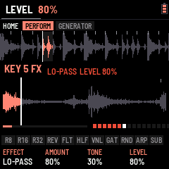

## 4. The pads

The black keys act while held and combine. Which key does what is a **layout** (ARP › BLACK KEYS, below): CHOPPAH's,
left to right R8 R16 R32 REV FRZ HLF VNL GAT RND FLT DUB (a new FM-1's, after RESET ALL too; BEGINNER keeps the layout EXPERT left, 0.9.23),
FLEXOR LAYOUT (R8 R16 R32 RND HLF FLT ARP VNL KIL DST SUB, 0.9.26) or CUSTOM, each key any of the fifteen below. (HOME's K1 is
the gate and K2 the DJ filter as well.) While a pad is held, the slice blocks give way to an
animation of what it does, and **K1–K4 tune that pad** (the foot shows its settings; SAVE keeps them):

| Pad | Does | K1 | K2 | K3 | K4 |
| --- | --- | --- | --- | --- | --- |
| R8 · R16 · R32 | Roll from the next 16th | RATE (3/8, 1/4, 3/16, 1/8, 3/32, 1/16, 1/32, 1/64, then the triplets; the dotted ones since 0.9.30) | THRU: BREAK (the break rolled, as ever), KICK (the kick hit at the rate instead of its pattern: a kick roll; the break plays on), BOTH (the two); **SEL + the pad**: the kick alone, for that press, whatever THRU says | DRUM FLT (HOME's drums' filter) | DECAY: DOWN (each repeat quieter) or UP (a swell up to full) |
| REV | Reverse | Speed | | | LATCH: ON, a press turns it on and the next off (0.9.26) |
| FRZ | FREEZE: the slice playing loops while held | LENGTH: the slice, 1/2, 1/4, 1/8 | PITCH (±12 semitones) | | LATCH: ON, a press turns it on and the next off (0.9.26) |
| HLF | Half speed | Speed | MASTER TEMPO: the pitch kept (ON) or dropped | LATCH: ON, a press turns it on and the next off | |
| VNL | VINYL BREAK: the record slowing to a stop, spinning back up when let go | Stop (beats) | Spin-up | THRU: the break, the kick or both | |
| GAT | Gate: the break chopped on the beat | RATE | LENGTH (how much of each gate sounds) | | LATCH: ON, a press turns it on and the next off (0.9.26) |
| RND | Random slices | Amount | Random pitch | | LATCH: ON, a press turns it on and the next off (0.9.26) |
| FLT | Filter throw: the DJ filter sweeps to its target while held, back when let go | TARGET (low-pass left, high-pass right) | RESO | SPEED | THRU: BREAK (the break, as ever), DRUMS (the kick, the snare, the hat, the clap), BOTH (0.9.26) |
| DUB | Dub throw: the break into an echo while held, its tail ringing out | TIME (1/8, 3/16, 1/4, 3/8) | FEEDBACK | TONE | MIX (with a DELAY in the FX chain: that slot's own four) |
| ARP | Its OVERLAY effect over the mix, while held (or latched): DIVE, RISE, RADIO, WAH, CRUSH, LO-FI, DIST, RING, CHOP, GATE, DUCK, PAN, BOOM, WOBBLE, JET, REESE | EFFECT | AMOUNT (that effect's) | TIME: RATE for CHOP, GATE, WAH, PAN; SWEEP for DIVE, RISE | LATCH |
| ARP, FX while held (MORE) | | THRU: BREAK, KICK or THRU (everything; LFO's ARP the same) | ON / OFF (OFF: K1 browses silent) | RATE (1/4 … 1/32) | SWEEP (1/4 bar … 2 bars) |
| KIL | While held, the sequencer's kicks are quiet; let go, they play again (a kick roll still plays) | LATCH: ON, a press quiets them and the next brings them back | | | |
| DST | A switch: a press, the kick's DISTO off, the next on again; its amount is never touched (at 0 % it stays 0 %: turn DISTO up to hear it). Lit while it is ON, even at 0 % (0.268); the kick's own (KICK 1–20): another kick picked (PRESETS, a track's item, a build) brings its own ON or OFF, the key lit with it; saved with SAVE. In BEGINNER too when its layout has DST (0.9.24) | | | | |
| SUB | A press: the kick's SUB DRIVE on, the next off (its drive is the SUB layer's DRIVE effect, EDIT); the kick's own, as DST: each kick brings its own ON or OFF, the key lit with it | | | | |

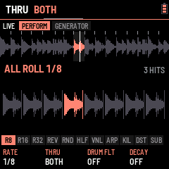
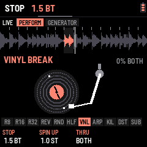

## 5. Patterns and the sequencer

LOAF BREAKER holds **64 patterns**, P1–P64. Each is the break's 32 steps (2 bars), each step playing the loop's own
slice (LOOP, where the generator can move it), a slice of its own, or nothing; and three drum lanes of 16 steps (kick,
snare, hat) that repeat every bar. **PRESETS** picks the pattern on most pages (left of P1: P64); while playing, the
next one starts when the loop comes round (the header shows "P2>").

**Four groups of 16.** The FM-1 keeps one group in memory at a time: P1–16, P17–32, P33–48 or P49–64; the others wait
in its flash. Within a group nothing changes. Going to another group reads it in, so the sound plays on, with one
exception: if the group you leave has changes not yet saved, they must be written first, and a write cuts the sound for
a moment. So, stopped, they are saved on the way (no sound to cut); playing, the FM-1 stays where it is and says
**SAVE OR STOP**: press SAVE (or stop), then pick the pattern again. The same goes for a track or a drop that leads into
another group. A new group starts with 16 empty patterns; what you had before this version is P1–P16.

**SEQ** opens the sequencer. **SELECT** picks what the white keys edit; **ALGORITHM** the bar shown of a long lane (a kick of 32 or 64 steps, a drum of 32: bars 1–4, round; the break: its two halves; a lane of one bar: the next lane, as SELECT; 0.9.26, FLEXOR) (0.9.2: **SEQ again** goes back to HOME):

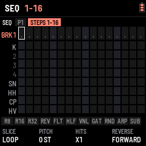 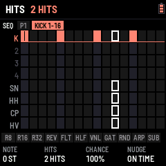

| Lane | White keys | K1 | K2 | K3 | K4 |
| --- | --- | --- | --- | --- | --- |
| **BREAK** (EXPERT: above the first lane; the tab says BREAK) | Play slices | | | | STEPS: the break's rows the grid shows, HIDDEN, 16 (BRK1) or 32 (BRK1 and BRK2, as to start); the pattern plays 32 steps whatever (hidden rows: ALGORITHM passes them by) |
| STEPS 1-16, STEPS 17-32 | Pick a step to edit (outlined) | SLICE: OFF · LOOP · 1–16 | PITCH: −12 … +12 | HITS: ×1–×4 (a ratchet in the step) | REVERSE |
| KICK, SNARE, HAT, CLAP | That lane's 16 steps, on and off (as the key comes up) | FILL: 0–16 hits spread evenly from the downbeat (Euclidean) | DRUM FLT (HOME's drums' filter) | Left CLEAR, right 4X4 (the lane's bar shown) | LENGTH: 16 or 32 steps (the kick: 16, 32, 64) |
| **A step held** (a drum lane) | its own, the foot naming them | NOTE: −8 … +7 semitones (the kick's) | **HITS**: 1–4, the step taps that many times in its 16th | **COND**: ALWAYS, 75 %, 50 %, 25 % (it plays that often), 1:2 (the first loop of two), 2:2 (the second), (FILL and NOT FILL, from before 0.244: always) | **NUDGE**: on time .. 7/16 of a step late |

The upper strip shows the half's 16 steps (a number: its own slice; a dot: LOOP; a dash: off; a mark under it: hits
or reverse), the step playing lit; the lower strip all three drum lanes.

**REC** records: while it is lit and the break plays, every white key you press (on HOME and the other pages where
the keys play slices) is written into the pattern at the step it lands on, and so are MIDI notes: 48–63 as slices,
36 / 38 / 42 into the kick, snare and hat lanes. REC again stops. **SEL + REC** clears: on SEQ the lane shown, on any
other page the whole pattern. **SEL + SAVE undoes**
either (and FILL, CLR / 4X4 and COPY on a drum lane, and the SEQ-held moves below); press it again to redo. SAVE keeps
all 16.

**SEQ's hands** (on SEQ):
- **Playing, the keys follow the bar playing**: on a lane of 32 or 64 steps (the break, a kick of 64, a snare of 32),
  the lane shown moves on with the bar the sequencer plays, so you write where you hear. SELECT (a lane) or ALGORITHM (its bar) picks by
  hand: then it stays put until you stop.
- **SEQ held + white key 1–4**: the bar shown copied onto bar 1–4 of the same lane (its steps, their HITS, COND, NUDGE
  and notes): write the kick's first bar, then copy it onto 2, 3 and 4.
- **SEQ held + K1**: the whole lane (every bar of its drum, or the break's 32 steps) a step later (right) or earlier
  (left), round: shift a FILL or look for a groove.
- **SEQ held + REC**: every drum lane of the pattern cleared, the break's steps kept.
- **REC on, playing, a drum lane**: any white key plays that lane's drum and writes it at the nearest 16th, where it
  lands: tap the rhythm in rather than draw it.

### OVERLAY (ARP)

**ARP** opens the OVERLAY page: sixteen effects over everything that plays, one on each white key (DIVE, RISE, RADIO,
WAH, CRUSH, LO-FI, DIST, RING, CHOP, GATE, DUCK, PAN, BOOM, WOBBLE, JET, REESE), on while the key is held, any
together. **K1** the amount of the one touched last, **K2** the rate of the ones on the beat (CHOP, GATE, WAH, PAN),
**K3** the sweeps' length (DIVE, RISE), **K4** LATCH: on, a key switches its effect on and off (and what is latched
stays on on the other pages). The page and the ARP black key share one effect (0.9.27): a white key touched here is the ARP key's effect, and the one K1 tunes; the ARP key's K1 turns it, the page follows; AMOUNT, RATE and SWEEP are the same on both. The white keys of the effects on are lit (held, latched, the ARP key's). (The FILL that ARP held
played from 0.1xx to 0.243 is gone, LOAF BREAKER 0.244.)

In EXPERT the page has two tabs (**SELECT** goes to the other, 0.9.2; **ARP** again goes back to HOME): **ARP EFFECTS** (the above)
and **BLACK KEYS**. **BLACK KEYS** lays out the black keys: **K1 PRESET**, CHOPPAH (CHOPPAH's eleven, the ARP
key not among them), FLEXOR LAYOUT (R8 R16 R32 RND HLF FLT ARP VNL KIL DST SUB since 0.9.26) or CUSTOM; **K2 KEY** (or **ALGORITHM**, 0.9.26), the key you edit (or press it:
here a black key picks itself and plays nothing); **K3 EFFECT**, what it does: any of R8, R16, R32, REV, FRZ, HLF, VNL,
GAT, RND, FLT, DUB, ARP, KIL, DST, SUB. Turned on a preset, K3 makes a CUSTOM of it first, that key changed (keys
outlined amber differ from CHOPPAH's). SAVE keeps the layout. BEGINNER always plays CHOPPAH's (turning BEGINNER on
sets it back to CHOPPAH, and EXPERT keeps it until you change it).

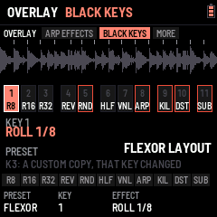

**PATTERN › GROOVE** (SEQ's SELECT past the last lane or above BREAK, or **SEL + ARP**) holds the swing (saved
with the rest): **K1 SWING**, 50–75 % (was the MIXER's), every second 16th later; the page shows the bar's 16ths as it
lays them out.

## 6. The FX chain

**FX** opens the master effects chain: four slots in series, the break (through its DJ filter, with the kick when it
goes through the chain) into slot 1, then 2, 3 and 4, then on to the drums when they go around the chain, the DUB
pad's delay and the limiter. Each slot holds any effect (two of one are fine), with
three settings, a mix and a bypass, and more knobs on two more parts (MORE and MOD, below). The screen shows the
effect you tune as a live picture; under it the chain in order (yours lit, the bypassed ones dim), its modulator and
its level in and out.

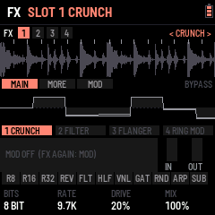

| Control | Does |
| --- | --- |
| SELECT | The slot to tune (1–4): the tabs at the top (0.9.2; ALGORITHM before) |
| ALGORITHM | The slot's part, MAIN, MORE, MOD, either way (an MB COMP: its six): the tabs below (0.9.2; FX again before) |
| FX again | Back to HOME (0.9.2): SELECT and ALGORITHM move everywhere in it. On the kick's own FX (EDIT › FX), FX again still steps MAIN, MORE, MOD |
| PRESETS | The effect in that slot, through the library (EMPTY first); a new effect comes in on, as you last left it (its MORE and MOD too; never touched: its starting settings) |
| SEL + REC | The slot's effect back to its starting settings (its MORE, MOD and MB COMP detail too); SEL + REC again within 4 s takes the reset back. On EDIT KICK's FX parts the same for that layer's effect, which is also remembered effect by effect |

**KICK FX** (EDIT KICK's sections FX1 and FX2, after DIRT): the FX page on the kick's own two slots,
after its EQ and before everything else (the break's chain never sees them). Every effect of the library but REVERB
and DELAY; **PRESETS** the effect (remembered as left, apart from the chain's; 0.9.29: in the FX section PRESETS goes through the effects alone, nothing on EQ B and EQ S, and SEL + PRESETS changes the kick), ALGORITHM the next part of the effect (MAIN, MORE, MOD, or
the MB COMP's), SELECT the kick's next section, FX the next part of the effect too, FX held + ALGORITHM moves the slot, SEL + FX bypasses, SEL + REC resets.
FX from another page: the chain. **Each kick has its own FX section** (EQ B, EQ S, FX1, FX2: KICK 1–20 each its own,
0.9.26): another kick picked brings its own EQ and effects.

**BEGINNER's chain.** In BEGINNER mode the FX page has two slots (the third and fourth are muted and hidden; EXPERT
gives them back as they were) and PRESETS turns through a short list: EMPTY, FILTER, CRUNCH, DRIVE, FLANGER, REVERB,
DELAY, TAPE, CLIP, then **MAGIC EQ** and **MAGIC MBC**. Each slot keeps its settings (K1–K3, K4 its mix).

**MAGIC EQ** and **MAGIC MBC** are FLEXOR's own, at the very end of PRESETS (past CLIP), in the FX chain and in KICK
FX. MAGIC EQ is an EQ: LOW −5.8 dB (shelf at 182 Hz), MID −2.9 dB at 999 Hz (Q 1.59), HIGH +1.9 dB (shelf at 8 kHz),
0 dB out. MAGIC MBC is an MB COMP split at 200 Hz and 2.5 kHz with a hard knee: the LOW at 0 dB, 8:1 (10 / 150 ms)
and 6 dB down, the MID at −34 dB, 3:1 (5 / 100 ms), the HIGH at −48 dB, 2:1 (2 / 60 ms) and 2 dB up; the AMOUNTs at
4.5:1, 1.7:1 and 1.5:1, 60 % wet. Both stay what they are underneath: every knob and part works as on a plain EQ or
MB COMP.

| K1–K3 · K4 | Its settings · its mix |
| SEL + FX | That slot on / bypassed |
| FX held + ALGORITHM | Moves that slot along the chain (the order is the sound: DRIVE before a FILTER is not a FILTER before DRIVE) |
| MIX SENDS K1 FX | The whole chain against the dry sound: fade every effect in or out at once (the FX page shows it, bottom right) |

| Effect | K1 | K2 | K3 |
| --- | --- | --- | --- |
| FILTER | Cutoff (30 Hz – 16 kHz) | Resonance | Mode: LP · BP · HP |
| CRUNCH | Bits (16 → 2) | Rate (44.1 kHz → 1 kHz) | Drive |
| DRIVE | Gain (×1 – ×30) | Tone (dark → bright) | Level |
| PUNCH | Amount (a drum-bus compressor; low MIX for parallel squash) | Attack (0.1 – 30 ms) | Release (20 – 500 ms) |
| FLANGER | Rate (0.02 – 10 Hz) | Depth | Feedback (−90 … +90 %) |
| RING MOD | Frequency (20 Hz – 2 kHz) | Spread (the right side higher) | |
| TREMOLO | Rate on the tempo (1/2 … 1/32, 1/8T) | Depth | Pan (0 tremolo … 100 % auto-pan) |
| REVERB | Size (short room … long hall) | Tone (bright … dark) | Pre-delay (0 – 60 ms) |
| DELAY | Time on the tempo (1/16, 1/8, 3/16, 1/4, 3/8, 1/2, 1/8T, 1/4T) | Feedback | Tone (dark … bright repeats) |
| EQ | Low (a shelf at 120 Hz) | Mid (a bell; K4 is its frequency, 200 Hz – 5 kHz) | High (a shelf at 8 kHz) |
| TAPE | Drive (0 – 24 dB into a tape curve: denser, warmer, even harmonics; the peaks kept level) | Warmth (the low head bump, the top rolled off) | Wow (and flutter: the pitch wanders like a worn machine) |
| MB COMP | Low amount | Mid amount | High amount (five more parts of its own: below) |
| CLIP | Drive (0 – +24 dB into it) | Knee (soft … hard) | Ceiling (0 – −12 dB) |

**EQ**'s bands go −12 … +12 dB, flat in the middle; its K4 is not a mix but the **mid's frequency** (**MID FREQ**, in Hz: 1.5KHZ is 1,500 Hz); its MORE part has the mid's width (**MID Q**: low, wide; high, narrow). **TAPE** is a
saturator after a tape machine: put it last in the chain to glue the break, or before CRUNCH for a dusty sampler.

**MB COMP** is a 3-band (multiband) compressor, and the one effect with a page of its own (below). The heaviest effects on the FM-1's processor are **TAPE** and the **MB COMP**s (MAGIC MBC too), then FLANGER and EQ: if the screen says **OVERLOAD · FX SLOT BYPASSED**, the sound got close to its limit twice in a row and the chain's last slot on was switched off for 2 s; fewer of those (or SYSTEM › MIDI K3 METER, in EXPERT, to watch the CPU) keeps it clear. **CLIP** squares
the peaks off at its ceiling: soft rounds them, hard cuts them; below the ceiling it only adds its drive. MB COMP then
CLIP last in the chain is a loud master; CLIP before a FILTER is a fizzy one.

**DELAY** is a stereo ping-pong: the echoes bounce left, right, left, each darker. Its K4 is **SEND**, how much of the
sound reaching it goes in (the echoes come back at full), so with SEND low only throws ring out: the DUB pad, the
the slices' ECHO. There is one delay (0.74 s at most: 1/2 at 162 BPM and up; slower, it holds the
longest it can).

**REVERB** is a plate (after Dattorro's design: diffusers, then a modulated stereo tank): its MIX is how much reverb
goes over the dry sound. The tail rings on after STOP. There is one: a second REVERB slot passes the sound on. Put it
late in the chain to reverb the effects before it, or early to crunch or drive the reverb itself.

The chain starts as CRUNCH → FILTER → FLANGER → RING MOD, all bypassed: SEL + FX switches the focused one on.
CRUNCH used to be HOME's K4; it is slot 1 now.

STOP fades the break out at once (a white key held keeps looping); the reverb's and the dub delay's tails ring on.

### Each effect's view, MORE and MOD

Every effect (but MB COMP, which has its own page, below) has three parts, stepped by **ALGORITHM** (FX again on the kick's own FX): **MAIN** (its
three settings and mix, as in the table above), **MORE** (its extra knobs) and **MOD** (a modulator that moves one of
its settings in time). The tab bar names the part (`< FILTER MOD >`), the strip shows it lit.

The picture above follows the sound as you turn:

- **FILTER, FLANGER:** the response from 20 Hz to 20 kHz (the cutoff and resonance; the flanger's comb sweeping as
  it plays). **EQ:** its three bands, ±12 dB about the middle line.
- **DRIVE, CLIP, TAPE, CRUNCH:** a tone through it, the clean tone grey behind: rounded, squared, folded, stepped.
  **PUNCH:** two hits, their peaks held down. **RING MOD:** the tone times its carrier. **TREMOLO:** a tone under two
  of its cycles.
- **REVERB:** its decay over 3 s (0 to −60 dB), the pre-delay a gap. **DELAY:** its echoes, left up and right down,
  each quieter by the feedback.

Below: the chain, then the modulator's cycle with where it is now (the white dot) and what it moves, and the
effect's level in and out.

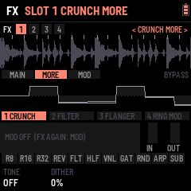

| Effect | MORE K1 | K2 | K3 | K4 |
| --- | --- | --- | --- | --- |
| FILTER | Drive into it | Slope: 12 · 24 dB | Spread (the right's cutoff higher: a stereo filter) | |
| CRUNCH | Tone (a low-pass after it; OFF at full) | Dither (noise under the steps) | | |
| DRIVE | Shape: SOFT · TUBE · HARD · FOLD | Bias (lopsided: even harmonics) | Low cut before it (OFF … 800 Hz) | |
| PUNCH | Ratio (1.5:1 … 20:1) | Make-up (+0 … +12 dB) | SC HPF (the lows don't pump it; OFF … 300 Hz) | |
| FLANGER | Delay (where the sweep starts, 0.2 – 2.7 ms) | Spread (the right's phase, 0 – 180°) | Sync (OFF, or the sweep on the tempo: 4 bars … 1/4) | |
| RING MOD | Wave: SINE · TRI · SQUARE | Mode: RING · AM | | |
| TREMOLO | Shape: SINE · TRI · SQUARE · SAW | Smooth (the edges rounded) | | |
| REVERB | Width | Low cut into it (OFF … 600 Hz) | Mod (the tail's wobble) | Diffusion |
| DELAY | Width (mono … full ping-pong) | Low cut in its loop (each echo thinner) | Duck (the echoes duck under what plays) | |
| EQ | Low shelf's frequency (40 – 400 Hz) | Mid's Q (0.3 – 4) | High shelf's frequency (2 – 16 kHz) | Level (±12 dB) |
| TAPE | Flutter | Wow's rate (0.1 – 3 Hz) | Hiss | |
| CLIP | Bias (lopsided) | Output (−12 … 0 dB) | | |

Every MORE knob starts where the effect always was, so a saved sound plays as it did.

| MOD | K1 | K2 | K3 | K4 |
| --- | --- | --- | --- | --- |
| | Rate on the tempo (4 bars … 1/16, 1/4T, 1/8T) | Depth (OFF in the middle; left moves it the other way) | Shape: SINE · TRIANGLE · SAW · RAMP · SQUARE · S&H · ENV | Target: the effect's K1, K2, K3 or MIX |

**ENV** follows the effect's own input: the louder the break hits, the further it moves (a filter that opens on
every snare, a drive that bites on the kicks). **S&H** jumps to a new random place each cycle. The foot shows the
setting it moves as the modulator leaves it.

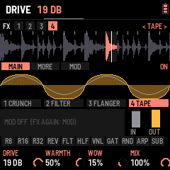

### MB COMP

The break is split into a low, a mid and a high band (by default at 200 Hz and 2.5 kHz), each pressed on its own and
added back together; with nothing pressed the bands add back up to the sound untouched. Focus an MB COMP slot and the
screen turns into the compressor:

- **Above:** its six parts as tabs, then the spectrum from 20 Hz to 20 kHz in the three bands' colours (low red, mid
  amber, high blue). The filled shape is what the sound goes through right now: a band being pressed **dips**, a band
  turned up with GAIN stands above the 0 dB line, and the dotted line shows where it would be with nothing pressed.
  The splits are marked with their frequencies.
- **Below:** each band's curve, input across and output up (−48 … 0 dB): flat at 1:1, bending at the threshold, the
  knee rounding the bend. The white dot is the band's level, riding the curve as the break plays. Beside it, the
  band's level in (the threshold marked white) and its reduction hanging from the top in amber, its peak held for a
  second. On the right, the ratio, the threshold and any gain as they act now; at the top, the reduction in dB.

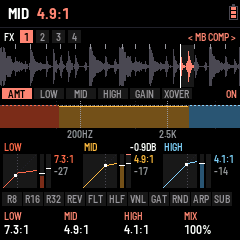

**FX again** steps through the six parts and back to AMOUNT, staying on the slot; ALGORITHM jumps straight to another slot
(and an MB COMP there opens on AMOUNT). The tab bar names the part: `< MB COMP LOW >`.

| Part | K1 | K2 | K3 | K4 |
| --- | --- | --- | --- | --- |
| AMOUNT | Low amount | Mid amount | High amount | Mix (parallel: the pressed sound against the dry) |
| LOW · MID · HIGH | Threshold (−48 … 0 dB) | Ratio (1:1 … 20:1, LIMIT) | Attack (0.1 – 100 ms) | Release (10 – 1000 ms) |
| GAIN | Low gain | Mid gain | High gain (each −12 … +12 dB) | Solo: OFF, LOW, MID, HIGH |
| X-OVER | Low split (40 – 800 Hz) | High split (1 – 12 kHz) | Knee (hard … 12 dB soft) | Output (−12 … +12 dB) |

The **amounts** are the knobs to ride while playing: each takes its band from untouched (OFF) to its own threshold and
ratio, and the foot shows the ratio it reaches. The band parts set where full amount lands: by default −30 dB and
8:1, the low slow (10 ms in, 150 ms out), the mid at 5 / 100 ms, the high fast (2 / 60 ms). Half of a band's
reduction at full scale is made back up by itself; GAIN adds or takes away more after it. **Solo** plays the one band
alone, with no dry sound under it, to hear exactly what it holds while you move the splits. The page outlines the band
whose part you are on.

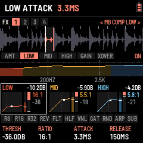

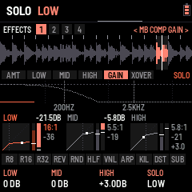

## 7. SYSTEM (GLO): MIDI, setup, screen effects, reset

**GLO** opens SYSTEM: the slice blocks give way to the state of MIDI, and K1–K4 set it (SAVE keeps it); in EXPERT, K3 is
the **METER** (below).
**SELECT** (or ALGORITHM) turns to SETUP (0.9.2; GLO again goes back to HOME): the skins, the mode and AUTO SAVE; then EFFECTS, FX SET and RESET (below). LOAF BREAKER has no Bluetooth: MIDI goes over USB and the TRS jack. On a computer the FM-1 shows as **LOAF BREAKER FM-1** (a MIDI device and, for recording, an audio input).

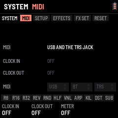

| Knob | Sets | |
| --- | --- | --- |
| K1 CLOCK IN | OFF · FOLLOW | Following, MIDI clock from USB or the TRS jack sets the tempo (the header says EXT; SELECT waits), START plays from bar 1, STOP stops, and the loop eases onto the clock's beat every beat. The clock is stamped where it lands, so the tempo it reads is steady |
| K2 CLOCK OUT | OFF · ON | While playing, 24 clocks a beat (straight, whatever the swing); PLAY sends START, stopping sends STOP, HOME + PLAY sends START again |
| K3 METER | OFF · ON | (EXPERT) CPU, IMG, FR in the header: the audio's load, the screen's |

The panel shows the clock coming in (its tempo, where from, running or stopped), the clock going out, and a light for
MIDI in and out on each port. The FM-1 has no MIDI out jack: MIDI goes out over USB only.

**The break's sound: pitch and snap (SOUNDS › BREAK: SEL + EDIT from the drums, or twice from the kick; ALGORITHM there: the break):**

| Knob | Sets | |
| --- | --- | --- |
| K1 PITCH | KEEP LENGTH (the default) · SPEED | KEEP LENGTH changes the pitch only: each slice keeps its length (a granular pitch shift), so a key pitched +7 still fills its loop. SPEED is the classic repitch: up plays faster and shorter, down slower and longer (K1 left) |
| K2 GRAIN | 10 … 80 ms | KEEP LENGTH's grains: shorter keeps hits tight, longer sounds smoother on held sounds |
| K3 SNAP | OFF · 1/8 · 1/4 · 1/2 · 1 (the default) · 2 · 4 slices | Where a white key pressed while playing lands: at once (OFF), or at the next point of a grid that many slices apart, counted from the top of the pattern. The panel says what it is in this break (on the 2-bar breaks 1 slice = 1/8, 1/2 slice = 1/16, 2 slices = 1/4). Stopped, keys always play at once |
| K4 LEVEL | 0 … 100 % | The break's level, the MIXER's BREAK (2 % a detent) |

It covers every pitch in semitones: OCT, a key's pitch, the roll's pitch a repeat, the freeze's pitch, steps. The
tempo's own repitch, HALF, REVERSE's speed and the tape stop stay speed effects.

**SETUP (GLO, then SELECT):** its four settings top to bottom, K1 to K4. K1 **SKIN**, the screen's colours (RED to start; the
whole screen changes at once), 24 chosen by FLEXOR, two rows of twelve swatches: CHROME, FIRE&ICE, CHOPPAH, GLOUPI,
TESS, OUTRUN, THUNDER, CYBERPUNK, MC SALO, ACID, RED, GARRY, PIP-BOY, NEON, BLACKLIGHT, PATINA, SYNTHWAVE, MIAMI, ELECTRIC,
ARCTIC, BREADCRUMBZ, IRIS, GLUCKSMAN, MAXENCE (an FM-1 updated from before keeps its colour, or the nearest left). **WAVE ZOOM** (K2 here until 0.9.1: HOME › SETTINGS K3 now, PRESETS on HOME too), how much of the past HOME's scrolling wave (the
CDJ view) holds across the screen: 1/2, 2/3, 5/6 of a bar (zoomed in), 1 BAR (as it was), 1 1/4, 1 1/2, 2 BARS (zoomed
out). K3 **MODE**: TUTORIAL (left of BEGINNER: the tutorial, above), BEGINNER or EXPERT (right). **BEGINNER** keeps
each thing to its essentials, to play the machine before learning it: the **KICK** is three pages, EDIT again (or
ALGORITHM) going round them: **KICK** (K1 **PRESET**, the built-in kicks; K2 **DISTO**; K3 **SUB DRIVE**, the SUB
through its drive, OFF at the left; K4 **DRIVE**, the whole kick's), **SHAPE** (K1 **P DROP**, the pitch's fall at the
hit; K2 **DROP TIME**, how long it falls; K3 **TAIL**, the SUB's length; K4 **TAIL MODE**, CLASSIC or CLEAN) and
**MIX** (the four layers' levels: SUB, PUNCH, GRIT, CLICK), its pages as tabs at the picture's foot, the header's tabs
the sounds, KICK, SN, HH, CP, **SELECT** going round them (on the drums' page too); the drums' page is PRESET, FX, LEVEL and DECAY; the **FX**
chain has two slots and a short list on PRESETS, MAGIC EQ and MAGIC MBC at its end (above); FX again stays on MAIN;
the MIXER has LEVELS and SENDS; on SEQ, the break's two halves (BRK1, BRK2) always on top of the grid, and SELECT goes round the lanes (no GROOVE
between them: SEL + ARP opens it); on the drum lanes K1 is **FILL**, K2 the lane's sound, K3 CLR / 4X4, K4 **LENGTH**
the kick's alone (16, 32 or 64 steps; turning BEGINNER on
sets every kick and drum of the group to 16; a drum lane stays 16, "LONGER: EXPERT MODE"), and a step held has no menu (the key just
turns the step on or off); SONG is whole, as in EXPERT (0.9.22: every knob, ALGORITHM the items, PRESETS' BUILD KICK and TEMPO RISE); a white key held plays its loop with no knobs; the black keys keep the layout EXPERT left (0.9.23; a new FM-1
starts on CHOPPAH's: R8 R16 R32 REV FRZ HLF VNL GAT RND FLT DUB; ARP › BLACK KEYS, to change it, is EXPERT's), each with its knobs as in EXPERT; a knob BEGINNER leaves out is drawn blank
and says "EXPERT MODE" when turned; SOUNDS › BREAK keeps
its LEVEL (K4; the pitch is OCT's) and PATTERN › GROOVE its SWING.
Nothing is lost: EXPERT shows everything again, as it was left, and what BEGINNER sets is there to refine. A
new FM-1, the web emulator and RESET ALL ask for the mode first (BEGINNER chosen to start; RESET ALL as a first start:
its screen, the start screen, then the question); an FM-1 updated with its
settings saved stays as it was.
K4 **AUTO SAVE**, ON: what you change is saved by itself a minute after it changed, **never while PLAY runs**: once
PLAY has been **stopped for 20 s** (0.9.26; a save holds the sound for a moment, so not while it plays nor just after
the stop, while its tail rings; you can go on turning knobs and pressing keys meanwhile). SAVE saves at once.

**METER** (EXPERT only: SYSTEM › MIDI, K3; not saved: off at every start, and in BEGINNER): once a second the header
shows CPU (the share of its time the sound takes, average and peak: past ~85 % at its peak the sound is at its limit),
IMG (the screen strips sent that second) and FR (how many times a second the interface went round: the higher, the
quicker it answers). For telling what slows it down.

**EFFECTS (GLO four times):** the screen effects, **several at once**: white keys **1–7** turn each on or off (lit
while on), K1 points at one and K2 turns it on (right) or off (left). **CRT** (every other line dimmed, as an old
tube), **VHS** (bands that slip sideways), **GRAIN** (specks that move), **RGB** (the red a few pixels off the rest), **SHAKE** (the screen jolts on the kicks and at the drop), **STROBE** (the colours turn over
at the drop, and on the kicks when ON A KICK is past 50 %), **8-BIT** (fewer colours). VHS and RGB together, for one.
The waves' colours are HOME › SETTINGS' WAVE TYPE: **REKORDBOX** (the three bands mixed, white where they all are) or
**SERATO** (the bands as one hue from red through yellow and green to blue, never white). **EDIT VIEW** (KICK › KNOBS ›
TOOLS, **K3**, since 0.9.29; on this page before):
what the KICK menu's picture shows, **THE WHOLE KICK** (left) or **THE PART EDITED** (right): on a layer's page (SUB,
PUNCH, GRIT, CLICK, their effects) that layer alone, CLICK over 50 ms and PUNCH over 150 (the time at the top right),
STACK its attack's kick, the TAIL section the whole tail over a second; the other parts the whole kick.
**DRUM VIEW ZOOM** (KICK › KNOBS › TOOLS, **K4**, "DRUM ZOOM"): how much time EDIT's pictures show, the kick's and the drums': **AUTO** (as above: the
kick 500 ms in RGB, 250 in WAVE, each part its own with EDIT VIEW PART; a drum its decay and a bit), or **250 MS**,
**500 MS**, **750 MS**, **1 S**, **1.5 S**, **2 S** for every picture (zoomed out: a long hardcore tail seen whole). The time shows
under the pitch, top right of the kick's picture. On the FM-1 a longer picture takes longer to work out: at 2 S it follows a
knob less smoothly (the sound is never touched). RESET's SCREEN puts it back on AUTO.

**FX SET (GLO five times):** the effects' settings, for all those on: K1 **AMOUNT**, K2 **ON A KICK** (how hard each kick
shows; 0: nothing), K3 **AT THE DROP** (how hard the drop shows; 0: nothing), K4 **LENGTH** (how long those moments last:
50 % as given, 0 half, 100 % half as long again). 5 % a detent; 50 % each to start.

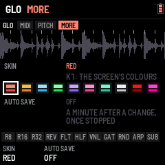

**RESET** (SYSTEM's last part): puts one part back as it starts, the rest kept. **K4** picks what, in a list that scrolls (ALGORITHM goes to SYSTEM's other parts, as on its other pages; each says
on the right what it puts back): DROP, BUILD, KNOB; **KICK** (the kick selected, KICK 1–20: ROTTERDAM again, its
SYNTH, BASS, CLEAN SUB and MORPH at 0, its volume kept, its memory with it); **KICK TONE** (its EQ flat, its two FX slots empty);
**ALL KICKS** (KICK 1–20 as they came, their knobs as they start); **DRUMS** (the snare's, hat's and clap's memory playing as it
came); **MIX** (the MIXER: levels, swing, the drums' route, COMP and DUCK off with their timing, MAX OUT −3 dB);
**FX CHAIN** (the four slots as they came, each effect's memory forgotten, the FX level kept); **STEPS** (this
pattern's drum steps: 1 hit, ALWAYS, on time; the steps themselves kept); **PADS** (the black keys' settings:
rolls, THRU, filter, gate, HALF's and KIL's LATCH, the ARP key's effect); **KEYS** (the white keys' loops and slice effects);
**TRACK** (this track: from its first item, every item's break SAME; its items kept); **SCREEN** (the skin RED, the
screen effects off, their settings at 50 %, WAVE ZOOM one bar); **WIPE MEMORY** (before installing another firmware: every save LOAF BREAKER keeps in the FM-1's memory erased, a sector at a time while the screen counts to 40, playing stopped first; then MEMORY WIPED, and nothing is saved again until the FM-1 restarts: install the other firmware next, and it finds that memory blank); and last **EVERYTHING**: RESET ALL, everything back
to how it came (tempo, generator, FX chain, the drums, mixer, keys, slices, SYSTEM, the tracks and all 64 patterns; the
first break, saved at once; the screen says so: LOBOTOMIZED, for 3 seconds). To reset it, **turn K2 five clicks**, each
within 2 s of the last (five boxes fill as you turn; a pause starts them again from 0), then **press GLO** within 5
seconds to confirm (the page says PRESS GLO TO RESET; not pressed, or the page left: nothing is reset). Once done, the page shows **DONE (WAIT 3 S)** and **every knob there does nothing for 3 seconds**: the clicks
you turn past the last one are lost instead of starting a new count, and DONE stays to read.

## 8. The drums: kick, snare, hat

Three synthesised drums play under the break, in time with it (swing included), on the pattern's drum lanes (§5):
their steps are SEQ's KICK, SNARE and HAT lanes; their sounds are made on **EDIT**. They go around the FX chain
(AROUND, the default on a new FM-1 and after a reset, whatever the mode: 0.9.2), or through it together when MIX ›
SENDS K2 says THRU; saved, THRU stays THRU at the next start.

**EDIT** opens SOUNDS' KICK (SELECT: its next section; EDIT again, EXPERT: the next sound, KICK SNARE HAT CLAP round, 0.266); **SEL + EDIT** the next source: DRUMS (SNARE, HAT, CLAP: **EDIT again** the next), BREAK, the KICK again (the tabs show which).
**ALGORITHM** turns through the drum's parts, **PRESETS** loads a built-in sound. The lower strip shows the three
drums side by side, each with its waveform (one hit, drawn again as you change the sound), the one edited outlined,
lit on its hits. The white keys keep playing slices.

### The kick

A synthesised kick for gabber, hardcore and techno. ALGORITHM turns through its parts: MIX → SUB → SUB FX → PUNCH →
PUNCH FX → GRIT → GRIT FX → CLICK → CLICK FX → MACRO → OUT (each layer's part is its LAYER knobs, its FX part its
LAYER FX knobs).

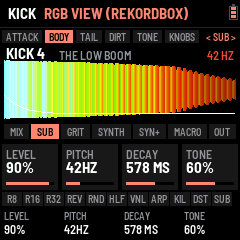 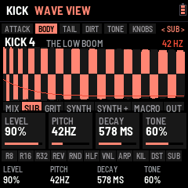 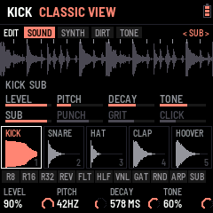 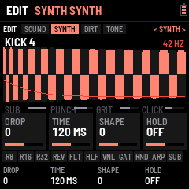

The kick is four layers summed and pushed into a clipper:

| Layer | Is | PITCH | DECAY |
| --- | --- | --- | --- |
| SUB | The low end: a sine dropping onto its pitch (TONE saturates it) | 30 – 90 Hz | 60 – 1500 ms |
| PUNCH | The hit and the body: a sine swept down fast (TONE: how far it sweeps) | 50 – 200 Hz | 20 – 400 ms |
| GRIT | The dirty mids: FM through a drive (TONE: more FM and noise) | 40 – 400 Hz | 20 – 800 ms |
| CLICK | The attack: a click and noise (TONE: from click to noise) | 1 – 12 kHz | 1 – 40 ms |

| Control | Does |
| --- | --- |
| ALGORITHM | The part: MIX, a layer (SUB, PUNCH, GRIT, CLICK), its FX, MACRO, OUT |
| PRESETS | The kick selected: KICK 1–20, each its own memory |
| OUT K4 PRESET | A built-in kick on the kick selected: 909, TECHNO, EARLY HC, ROTTERDAM (the start), INDUSTRIAL, DISTORTO. The steps, routing, volume and DISTO and SCREAM stay |
| MIDI note 36 (C1) | Plays the kick, from any channel, also while stopped |

| Part | K1 | K2 | K3 | K4 |
| --- | --- | --- | --- | --- |
| MIX | SUB level | PUNCH level | GRIT level | CLICK level |
| SUB · PUNCH · GRIT · CLICK | Level | Pitch | Decay | Tone |
| … FX | Effect: OFF · DRIVE · CRUNCH · FILTER · RING MOD | A (gain · bits · cutoff · frequency) | B (tone · rate · resonance) | Wet |
| MACRO | SUB (level, tail, weight) | PUNCH (level, sweep, click) | GRIT (level, dirt, tail) | INTENSITY |
| OUT | Volume | DISTO | SCREAM | PRESET (a built-in kick) |

**INTENSITY** is the drive into the clipper: low is a clean, round kick; past half the clip turns hard, the tail
flattens into the long, distorted gabber kick.

#### The KICK LAB (TAIL, TAIL +, STACK, TOOLS)

The KICK LAB is where a hardcore kick is built the way it is in a studio: its tail tuned and shaped, its attack
taken from another kick. Its pages sit where they act: **TAIL** and **TAIL +** in the TAIL section, **STACK** in
ATTACK, **TOOLS** in KNOBS. Everything in it is the kick's own (each KICK 1–20 its LAB), saved with SAVE; a kick with
nothing set there sounds exactly as it always did.

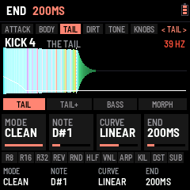 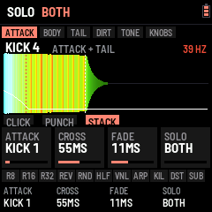

| Part | K1 | K2 | K3 | K4 |
| --- | --- | --- | --- | --- |
| TAIL | MODE: CLASSIC · CLEAN | NOTE: FREE · A#0 … A2 | CURVE: EXP · LINEAR · SNAP | END: OFF · 40 – 1000 ms |
| TAIL + | FILTER: OFF · 11 kHz – 190 Hz | F TIME: 20 – 600 ms | DRIVE: OFF · 1 – 100 % | |
| STACK | ATTACK: OFF · KICK 1–20 | CROSS: 10 – 300 ms | FADE: 2 – 150 ms | SOLO: BOTH · ATTACK · TAIL |
| TOOLS | MUTATE | A/B | | |

- **MODE CLEAN** fixes the "goofy" tail. In CLASSIC the kick fades *before* its distortion, so DISTO's fold and SCREAM
  change colour as it falls (the tail "talks": wah, yoy), and PUNCH and GRIT sit on notes of their own that rub
  against the SUB's. In CLEAN the distortion works on a steady sound and the fade comes after it, at the same
  loudness; PUNCH and GRIT land on the SUB's octave, GRIT's FM is harmonic, and the RUMBLE's echo is tuned to the
  note. The kick stays one note from the hit to the end.
- **NOTE** puts the tail on a note (the SUB's PITCH otherwise, FREE), shown in Hz at the top right: tune it to the
  track's key. **CURVE** shapes the pitch drop: EXP as always (fast, then a long slide), LINEAR and SNAP (high, then
  down fast) land exactly on the note at half the drop's TIME and stay there: no slide left in the tail.
- **END** cuts the kick (in 5 ms) at that length, white dashes on the picture: a tight tail at 200 BPM.
- **FILTER** closes a low-pass on the kick as it goes, from open at the hit down to its value in **F TIME**: the
  attack bright, the tail darker, the fizz gone. **DRIVE** pushes the tail (after the attack) harder into the clip:
  a denser, flatter tail.
- **STACK** is layering: **ATTACK** takes the hit from another kick (KICK 1–20, as it is in its memory, its own LAB
  too), this kick plays the tail. **CROSS** is where one hands over to the other (amber dashes on the picture),
  **FADE** how long the hand-over takes. **SOLO** lets you hear the attack alone or the tail alone (not saved).
  Two kicks sound at once until the hand-over: watch the METER (SYSTEM › MIDI K3) with STACK on.
- **MUTATE** (K1 right) moves the kick's layers and INTENSITY a little at random, each detent again; K1 left goes
  back to before the first. **A/B** (K2) swaps the kick you are editing (A) with itself as it came or was last saved
  (B); edit either, SAVE keeps the one playing.

OUT K4 PRESET (a built-in kick) turns the LAB off on that kick; COPY K n and SEL + ARP (copy, then paste on another kick) copy its LAB too; RESET KICK and ALL KICKS
turn it off. BEGINNER shows TAIL and STACK. The page is laid out as the snare's and the hat's: the part's four
settings as bars, under them the four layers' levels (the layer edited lit, amber with an effect on); the kick's
shape is its box in the strip below. Its steps: SEQ's KICK lane (empty to start).

### The snare and the hat

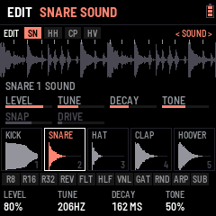

**EDIT** again from the kick: the snare, then the hat. **ALGORITHM** turns between its SOUND and SHAPE knobs,
**PRESETS** picks a built-in sound. Their steps: SEQ's SNARE and HAT lanes.

| Voice | Is | Presets |
| --- | --- | --- |
| SNARE | Two tuned sines with a pitch drop (the body) and band-passed noise (the snares), with a crack on the hit | 909 · TIGHT · FAT · GABBER, then FLEXOR's industrial ones: SHRAPNEL · GRINDER · PISTON · CONCRETE · BUNKER · SHRAP CRUSH · GRIND CRUSH · CONCR SMASH · GABBER BITS |
| HAT | Six square waves at the 808's ratios and noise, through two high-passes | CLOSED · 808 · OPEN · TRASH |
| CLAP | Noise bursts and a tail | 808 · 909 · TIGHT · BIG · BUNKER CLAP · FURNACE CLAP |

| Knobs | K1 | K2 | K3 | K4 |
| --- | --- | --- | --- | --- |
| SOUND | Level | Tune | Decay | Tone (the hat: METAL / NOISE) |
| SHAPE | Snap (the hat: CUT, the high-pass; the clap: SPREAD) | Drive | PRESET | **DIRT**: SOFT (as ever), HARD (a hard clip), FOLD (folded back, as the kick's DISTO), BITS (5 bits) |
| MORE | **DROP** (the snare: how far its body falls, x1.7 to x6) | **TIME** (how fast it falls, 3 to 140 ms) | **LIFT** (the tail brought up, the hit held down) | **ROOM** (a short room closed sharply after the hit: its level and its length) |
| BEGINNER | **PRESET** | **FX**: DRY · ROOM · CRUSH · SMASH (twice the drive, the tail lifted, a longer room) · SMASH+BITS | Level | Tune |

**ALGORITHM** goes through SOUND, SHAPE and MORE. FLEXOR's snares came out of three listening pages (gabber,
crossbreed, industrial: the drop, the dirt, the lift and the room); each comes with the FX it was chosen with, and in
BEGINNER the FX changes on the same preset (its LEVEL and TUNE kept). Each memory (SNARE 1-10 ..) keeps its own.

MIDI notes 38 (D1) play the snare, 42, 44 and 46 the hat, also while stopped. SAVE keeps the drums with the rest.
(ENV, which used to open SNARE / HAT, is TRACK now: §3.)

## 9. The mixer

**LFO** opens the MIXER: three channels side by side, each a fader (BREAK, KICK and PERC with a level meter).
**SELECT** turns to SENDS, MASTER and DYNAMICS (0.9.2; **LFO again** goes back to HOME): SENDS (the FX fader, the chain's four slots beside it, lit: on; DRUMS, their route; ARP, the ARP's effects on the BREAK, the KICK or THRU, everything: the same as the ARP key's THRU, also LEVELS' K4). **LFO held +
K1–K4**, on any page: the break's, the kick's and the drums' level, 5 % a detent (the MIXER's own page: 2 %), the page staying where it is (LFO let go after a turn opens nothing): the mix moved without
going into the MIXER.

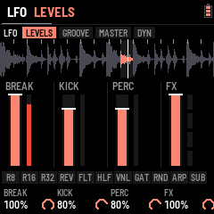 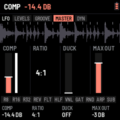

| Half | K1 | K2 | K3 | K4 |
| --- | --- | --- | --- | --- |
| LEVELS | BREAK: the break's level (its throws into the delay and the reverb too) | KICK: the kick's level (the KICK page's VOLUME) | PERC: the snare, the hat and the clap together | ARP: what the ARP's effects take, BREAK, KICK or THRU (the whole mix); the ARP key's THRU (0.9.29) |
| SENDS | FX: the master FX chain against the dry sound | DRUMS: through the FX chain or around it | ARP: BREAK, KICK or THRU, as LEVELS' K4 | |

FX is how much of the chain you hear (the drums routed around it stay dry). Bring BREAK down to drop the break and
let the drums run alone, then up again for the drop. HOME keeps the gate, FX and COMPLEXITY to ride (K1, K3, K4) and the **DJ filter** (K2), which filters the
break alone: sweep it down and the drums stay full on top.

## 10. Pages and knobs

| Page | K1 | K2 | K3 | K4 |
| --- | --- | --- | --- | --- |
| HOME (perform) | Gate | Filter: the DJ filter on the break (left low-pass, right high-pass) | Drum flt: the same on the drums | Sub decay: the kick's SUB's length |
| HOME again (generator) | Complexity | Anchor | Roll | Fill |
| EDIT, the KICK menu (SELECT: its section; ALGORITHM: its part; EDIT again: the next sound) | SOUND: MIX, SUB … CLICK, OUT · SYNTH: SYNTH, SYNTH +, BASS, CLEAN MORPH, MACRO · DIRT: DISTO, DISTO +, SCREAM, the layers' effects · FX: EQ B, EQ S, FX1, FX2 (§8) | | | |
| The drums (SELECT on the big view; SEL + EDIT; EDIT held: the other view) | Level · Snap / cut / spread / bend | Tune · Drive | Decay · Preset | Tone |
| SEQ (the break's steps) | Slice | Pitch | Hits | Reverse |
| SEQ, a drum lane | Fill | Sound: the kick (KICK 1–20), the drum's memory | Clear / 4x4 / grooves | Length |
| SEQ, a drum step held | Note (the kick's) | Hits | Cond | Nudge |
| ENV TRACKS (PRESETS: the track; a white key: its pattern in; SEL + PLAY: start here) | Item (ALGORITHM too) | Pattern / DROP / END | Loops | Its break |
| ENV PLAY (PLAY: the track) | Track | From item | At the end | |
| ENV DROP | Build bars | After the drop | Break | Crash |
| ENV BUILD (PRESETS: tempo rise) | Style | Sweep | Riser | Gap |
| EDIT KICK › KNOBS, K1 SET .. K4 SET (ALGORITHM: the knob; SEL + PRESETS: its function) | its function's four settings | | | |
| LFO (mixer: levels; LFO held, any page: the same) | Break level | Kick level | Drums level | FX (the chain, dry to wet) |
| LFO, SENDS (SELECT) | FX (the chain, dry to wet) | Drums: through the chain or around it | ARP: break, kick or thru | |
| LFO, MASTER | Comp | Ratio | Duck | Max out |
| LFO, DYNAMICS | Comp attack | Comp release | Duck release | Ducks: the break, or the break and the drums |
| FX (the chain; SELECT the slot, ALGORITHM its part) | the focused slot's effect: its three settings (ALGORITHM: its MORE and MOD parts; an MB COMP its six, see §6) | | | Its mix |
| GLO (MIDI) | Clock in | Clock out | | |
| SOUNDS › BREAK (pitch, snap) | Keep length / speed | Grain | Snap | Reset all (fifteen turns) |
| GLO, SETUP (SELECT) | Skin | | Mode: beginner / expert | Auto save |
| HOME three times (SETTINGS) | View: waveform / slices | Wave type | Wave zoom | Break time |
| GLO, EFFECTS (SELECT twice; keys 1–7: each on or off) | The effect | On / off | | |
| GLO, FX SET (SELECT three times) | Amount | On a kick | At the drop | Length |
| GLO, RESET (SELECT four times; ALGORITHM: what too; after a reset, 3 s at rest) | What | Reset (five clicks) | Reset (five clicks) | Reset (five clicks) |
| ARP (OVERLAY) | Amount (the effect touched last) | Rate | Sweep | Latch |

**Gate** (HOME K1) cuts every slice the loop plays short: at 50 % each slice sounds for half its length, then
quiet until the next; down to 5 % for clipped, staccato chops; 100 % is off. It follows the tempo and the pitch, and
the slice lit in the waveform shrinks with it. It covers the loop's slices, ratchets and the RANDOM pad; key loops
(their LENGTH) and rolls keep their own.

The generator rearranges the break as it plays: **complexity** is how often it jumps, **anchor** keeps the kick and
snare on the beats, **roll** repeats a slice or takes the one next to it, **fill** breaks the rules in the last bar
of a phrase; it is HOME's second part (HOME again). (ARP is the OVERLAY page; SEL + ARP the GROOVE.)

## 11. The control map

Every page, button, encoder and key in one place. On the site's manual
this section is interactive: pick a page and the screen, the seven encoders and the keys show what they do there;
below it, each button with its parts, the whole map as one table, and which of a held key, a held pad or the page
owns K1–K4. Here, in short: §2 has the rules, §10 every page's knobs.

## 12. Saving

SAVE keeps the tempo, pitch, swing, generator, the FX chain, the break chosen, each key's loop, the drums, the
mixer, the SYSTEM settings and the patterns (the group of 16 in memory: the others were saved when you left them); SAVE is lit when something changed. A new version keeps what an older
one saved: new settings start at their defaults. (Version 0.32 changed the layout: what 0.31 and older saved starts
over at the defaults once.) SYSTEM › RESET › EVERYTHING clears it all on purpose (§7).

## 13. Troubleshooting

- **No sound:** turn MASTER up; press PLAY.
- **A crash screen:** press a key to restart. Two failed starts in a row start safe mode, which the installer can
  still reach.
- **The install stops:** press Install again; it finishes a write that was cut off.
