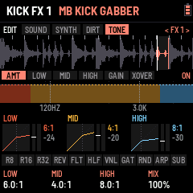

# LOAF BREAKER

LOAF BREAKER is a hardcore firmware for the M-VAVE FM-1, built by FLEXOR on **CHOPPAH**, Laurens Profittlich's Amen
chopper. A break is cut into sixteen slices, one on each white key, and plays in time while you rearrange it, roll
it, reverse it, stop it like a tape and push it through effects; under it a kick made for terror, gabber and
crossbreed (DISTO, its own synth, its own effects, notes on every step), a sequencer of 16, 32 or 64 steps, tracks
with built-up drops, a HOOVER, a compressor and a CDJ-style waveform of what leaves the mix.

---

## Start in five minutes

LOAF BREAKER turns the M-VAVE FM-1 into a hardcore break machine: a breakbeat cut into 16 slices, a distorted kick
built from scratch, drums, effects and drops. You don't need the whole manual to start: these five steps are enough.
The FM-1 starts in **BEGINNER** mode (GLO › MORE, K1): the advanced pages stay hidden until you want them.

### 1. Press PLAY

The break plays with its kick at once (NUSKOOL 140 to start). **ALGORITHM** picks the next break (it changes on the next
bar), **SELECT** sets the tempo, **PRESETS** the pattern (P1–P64). PLAY again stops.

### 2. Play the white keys: the slices

The 16 white keys are the break's 16 slices. Tap one: that slice. **Hold one: it loops** until you let go, in time.
Play two or three in turn and you are already chopping.

### 3. Hold a black key: the effects

The black keys act while held and can be combined: **R8 · R16 · R32** roll the break, **REV** plays it backwards,
**RND** shuffles the slices, **HLF** halves the speed, **VNL** stops it like a record,
**KIL** cuts the kick while held (let go: it drops back in, in time), **TER** turns the kick's DISTO off and
on again. While one is held, K1–K4 tune it.

### 4. EDIT: shape the kick

**EDIT** opens the kick, drawn large: what you hear, its pitch falling in amber. K1–K4 change the part shown;
**ALGORITHM** goes to the next part, **EDIT** again to the next section (SOUND, SYNTH, DIRT, TONE, KNOBS). Each part
says in a few words what it is for. Try **DIRT › DISTO** (K1: the distortion) and **SYNTH › BASS** (K2: the
rawstyle reverse bass). **PRESETS** there picks one of the 10 kick memories: each keeps its own sound.

### 5. Build and drop

**SEL + ENV**: a build from the next bar, then the drop. Then write your own patterns on **SEQ** (white keys: the
steps of the lane shown; ALGORITHM: the lane) and chain them on **ENV** (TRACKS: patterns and drops one after another).

### Two buttons to remember

- **SEL**, tapped alone: the card of shortcuts, those that work everywhere and those of the page you are on.
  Twice quickly: SEL stays held (lit) for one-handed shortcuts; once more frees it.
- **SAVE**: keeps everything (or GLO › MORE: AUTO SAVE).

When you know your way around: **GLO › MORE, K1 → EXPERT** shows every page (the kick's layers and their effects,
SCREAM and DISTO +, SYNTH +, CLEAN MORPH, each knob's settings…). The rest of this manual covers everything.

---

## Contents

1. Install
2. The screens
3. Playing
4. The pads
5. Patterns and the sequencer
6. The FX chain
7. GLOBAL: MIDI, pitch, skins, reset
8. The drums: kick, snare, hat
9. The mixer
10. Pages and knobs
11. The control map
12. Saving
13. Troubleshooting

---

## 1. Install

**Try it first:** the emulator runs the same code in the browser, with sound, played with the mouse.

**Install:** open the install page in Chrome or Edge, connect the FM-1 by USB and press Install. While it writes,
the FM-1 shows LOAF BREAKER's picture, UPDATING and DO NOT UNPLUG, and the bar fills. When it is done, the page
throws confetti. If the FM-1 runs M-VAVE's FM1 Open firmware, put M-VAVE's original firmware back first (M-VAVE's workbench, *Restore original*), then
install LOAF BREAKER.

## 2. The screens

At power-on LOAF BREAKER shows its picture, then the start screen: the loaded break drops in slice by slice while a light
runs through the buttons, they all flash as it completes, and PLAY blinks green. After two
seconds, or at once on any key, the **slicer view** opens. PLAY on the start screen also starts the break.

The slicer view, top to bottom:

- **Header:** play or stop, the break's name, the pattern (P1–P64; "P2>" while P2 waits for the loop's end), REC
  while recording, a level meter (left and right, what leaves after MASTER: amber from
  −8 dB, white near full scale), the tempo: lit white on each beat. The line under the header flashes on each kick
  and a tick under it walks the bar's four beats. The PLAY light blinks off on each kick, and during a build the
  next white key to light blinks, faster as the drop nears.
- **Tabs:** the button you pressed (as printed on the panel), then the page's parts as tabs, the one you are on lit:
  the button again (or ALGORITHM) goes to the next. On EDIT and FX the part edited shows at the right, "< SUB FX >".
  Opening a page, or turning to another part, says the same in the header for a moment: the button, then the part
  ("GLO PITCH", "EDIT KICK SUB FX", "FX SLOT 2 TREMOLO", "SEQ HAT"). The tabs sit right under the header on every
  page, tap tempo's too.
- **The break:** its waveform, the slice markers, the slice sounding lit, the playhead.
- **Slice blocks:** sixteen blocks, one per white key, each with its slice's waveform. The slice sounding is lit;
  a key held is outlined; a dot marks a key with a loop of its own (§3, key loops).
- **Pads:** the eleven black-key pads, lit while held.
- **Knobs:** the page's four knobs and their values; where the page knows how far a knob is turned (an FX slot, the
  MIXER's levels, the kick's classic view), an arc beside the value shows it.

**The rules.** ALGORITHM picks what you edit on the page (an FX slot, a drum's part, a SEQ lane, GLOBAL's part); on HOME (both its parts) and the MIXER, where there is nothing to pick, it is the break. PRESETS picks what goes
in (an effect, a kick, a snare or hat sound); elsewhere it is the pattern. **SEQ is where everything is sequenced**
(the break's steps and the kick, snare and hat lanes), **EDIT where the drums' sounds are made** (kick, snare, hat);
the white keys play slices everywhere but SEQ and ENV (tracks). **ARP held is FILL** (§5). **SEL + ALGORITHM is the break and SEL +
PRESETS the pattern on every page.** A page's button pressed again is its next part. **Press SEL** alone and the strip
shows a card: above, the four SEL combinations that work on any page; below, this page's own shortcuts (on HOME and
the pages without any: what SEL + K1–K4 turn). SEL again, or any other button, key or knob, closes it. The control map (§11) shows all of it at once.

## 3. Playing

| Control | Does |
| --- | --- |
| PLAY | Play / stop. HOME + PLAY: back to bar 1 |
| White keys | Slices 1–16. Playing: at the next snap point (GLOBAL: 1 slice, an 8th on the 2-bar breaks, by default; OFF, 1/8 … 4 slices). Stopped: at once. Held: the key loops (below), playing or stopped |
| SELECT | Tempo, 1 BPM a detent · **SEL + SELECT**, on any page: the drums' filter (DRUM FLT, as HOME's K3) |
| ENV | **TRACK**: tracks of patterns and drops, playing them, the drop's settings (below) |
| SEL (pressed alone) | The combinations card: every SEL combination on the strip. SEL used with something else (SEL + a knob, SEL + ALGORITHM, SEL + REC…) does that instead |
| SEL + ALGORITHM · SEL + PRESETS | The break · the pattern, from any page |
| SEL + SAVE | **Undo** the last pattern wipe (SEL + ARP, SEL + REC, a drum lane's FILL, CLR / 4X4 or COPY); again: redo |
| OCT− / OCT+ | Pitch in semitones (hold to go faster). Both: back to 0 |
| PRESETS | The pattern, P1–P64 (§5); while playing the new one starts at the end of the loop |
| SEQ · REC | The sequencer; recording the keys into the pattern (§5). SEL + REC: clear the pattern (SEL + SAVE takes it back) |
| MIDI notes | Notes 48–63 (C3–D#4) play slices 1–16, held like the white keys; 36 the kick, 38 the snare, 42 / 44 / 46 the hat (§8); any channel |
| ALGORITHM | (HOME, MIXER; SEL held: any page) The next or previous break: its name shows at once (amber in the header) and, while playing, it comes in at the next bar (the old one goes quiet for the bar's last 16th meanwhile); stopped, at once. THINK 114 (Lyn Collins), NUSKOOL 140, UPDOWN 165, APACHE 115 (Incredible Bongo Band), AMEN04 170, AMEN13 173, THEWORM 110 (Jimmy McGriff), AMEN19 172, AMEN15 174, BREAKIN 175 (the Amens: The Winstons, cut by Cyberworm): 2 bars each, played at the tempo you set |
| MASTER | Volume |

### Where things are

- **HOME**: playing. PERFORM and GENERATOR (HOME again: the other), the CDJ waveform on both.
- **EDIT**: the **KICK menu**. Its picture: the kick's hit over a quarter of a second, its wave large (the cycles
  stretching as its pitch falls, squared off where it is driven), its level behind, the SUB's pitch falling in amber,
  its memory (KICK 1–10), what the part is for in a few words ("FOLD DISTORTION") and its note; under it the part's four knobs as cards, their values large. **EDIT again**: the
  next section (SOUND, SYNTH, DIRT, TONE, **KNOBS**), **ALGORITHM**: the next part in it (each section remembers where
  you were). **KNOBS** puts the live knobs on the kick's picture: its first part, KNOBS, has K1–K4 turn what SEL + K1–K4
  turn (DRIVE, SCREAM, D+ SCREECH, DISTO to start: their first setting, their value large), so you hear and see the
  kick as you set them; then **K1 SET .. K4 SET**, each knob's function with all its settings (DISTO:
  AMOUNT, SUB, FIZZ, SUSTAIN; MORPH: AMOUNT, TO KICK…), the function's name by the kick's (KICK 4  K4 DISTO). They
  are the kick playing's (PRESETS on KNOBS: KICK 1–10, each its own). **On K1 SET .. K4 SET, PRESETS gives that knob
  another function** (the DISTO and SCREAM, DRIVE, DECAY, REV BASS, GLIDE, CLEAN SUB, MORPH and the rest), for
  the kick playing. **EDIT held** (half a
  second): the classic view (the part's knobs as bars, the layers' levels, the five drums' shapes, the break's wave
  above), held again: the big view; the part stays where it is. **Stopped**, anywhere in the KICK menu (the big view, the
  classic view, its EQ and FX) and on the other drums' pages (big or classic), **white keys 1–5 play the KICK, SNARE,
  HAT, CLAP, HOOVER** once each, to hear them (the number on each drum's card; on the big views the strip names the
  drum played); playing, the keys play slices as ever. **A built-in kick on the kick selected:** SOUND's last part,
  **OUT** (ALGORITHM to it), **K4 PRESET**: 909, TECHNO, EARLY HC, ROTTERDAM, INDUSTRIAL, DISTORTO, on the kick
  selected (PRESETS: KICK 1–10), its volume, steps and DISTO and SCREAM kept. **A kick copied onto another:** K4 PRESET past
  them, **COPY K1 … COPY K10**: that memory's kick, its SYNTH and its knobs (KNOBS, CLEAN SUB, BASS, MORPH) onto the
  kick selected, its volume kept (pick the kick to fill with PRESETS, then the one to copy with K4). On the big view, **SELECT** goes from drum to drum (the KICK,
  SNARE, HAT, CLAP, HOOVER, and round), each in a big view of its own: its hit drawn large over its level, its decay
  marked in amber, its memory and tune, the five drums along the bottom (stopped: keys 1–5 play them), the part's
  knobs as cards (ALGORITHM: SOUND or SHAPE, PRESETS its memories). SELECT is not the tempo there. **SEL + EDIT** opens
  the drums in the view the kick has (big or classic), and **EDIT held** switches them too, from either view: one view
  for the kick and the drums alike.

  
  - **SOUND**: MIX, SUB, PUNCH, GRIT, CLICK, OUT.
  - **SYNTH**: SYNTH, SYNTH +, BASS, **CLEAN MORPH** (K1 CLEAN SUB, K2 MORPH, K3 TO KICK: the kick's own, no knob
    needed), MACRO.
  - **DIRT**: DISTO, DISTO + (DRIVE, TYPE, SCREECH, TAIL), SCREAM, then each layer's effect.
    (DISTO, DISTO + and SCREAM were called TERROR, TERROR + and TERROR 2 before 0.191: names a newcomer reads.)
  - **TONE**: EQ BANDS, EQ SHAPE (its EQ), FX 1, FX 2 (its two FX slots).
  The DISTO and SCREAM's settings are the kick's own: they go with its memory. **SEL + EDIT**: the other drums (SNARE, HAT, CLAP,
  HOOVER; EDIT again the next, after the HOOVER the kick). The HOOVER (in the rave stab's place) is a hardcore synth:
  six saws spread wide, starting BEND octaves below and rising into its note (presets CLASSIC, DIVE, SCREAM, DARK).
  The kick's **SYNTH** section:
  - **SYNTH**: DROP (how far above its note the SUB starts its pitch drop: a soft thud .. a laser boom), TIME (how long
    the drop takes, 30–480 ms), SHAPE (the SUB's wave: a clean sine .. squared off, harder), HOLD (the SUB held at full
    before it decays, up to 250 ms: the long gabber "bwoom"; left: a shorter one).
  - **SYNTH +**: RUMBLE (the kick low-passed into a feedback line under it: the rolling hardcore rumble between kicks),
    LENGTH (the rumble's echo, 23–93 ms), ASYM (an uneven drive: even harmonics, warmer and harder), TUNE (the whole kick,
    −12 .. +12 semitones).
  - **BASS**: **GLIDE** (the kick's pitch sliding from one step's note to the next, 0–400 ms: give the kick's steps
    notes in SEQ and it slides between them), **REV BASS** (the rawstyle reverse bass: the kick's sub at its note
    swelling up between two kicks, cut as the next one hits; it goes through the kick's drive and DISTO), **START**
    (where in the beat it begins, 1/8 to 5/8), **CURVE** (how it swells: SLOW, SOFT, SHARP, SNAP).
  At 0 each sounds as the kick always did. They go with its memory (KICK 1–10); its PRESET puts them back to 0.
- **LFO** (the MIXER): LEVELS, GROOVE, MASTER (K1 COMP, K2 its RATIO, K3 DUCK, K4 MAX OUT; COMP's reduction metered),
  DYNAMICS (COMP's ATTACK and RELEASE, DUCK's RELEASE, DUCKS: the break, or the break and the drums).
- **ENV**: the song. TRACKS, PLAY, DROP, BUILD. (What SEL + each knob does: EDIT › KNOBS; RESET: GLO.)
- **GLO**: MIDI, PITCH, MORE (MODE, AUTO SAVE, SKIN, WAVE ZOOM), EFFECTS (several at once, keys 1–7), FX SET, RESET.

### The CDJ view (HOME)

**PERFORM and GENERATOR show what leaves the mix** (the break, the kick, the drums, the effects; before MASTER)
scrolling in from the right, the playhead at the right edge, as a track on a CDJ. Each column is coloured as
rekordbox's RGB waveform: the lows red, the mids green, the highs blue, mixed (a kick reads red to orange, a snare
green to cyan, the hats blue), as tall as its peak. 4 beats fill the screen; the beats are ticked top and bottom (the
bar's first lit) and the bar and beat counted top left. While a track plays, a line along the top shows how far
along it is, and "DROP IN 4" counts the bars to its next DROP. **Hold HOME** (a third of a second) for the slice blocks
instead, hold it again for the waveform; neither moves to HOME's next part.

 

### Tracks and drops (ENV)

**ENV** opens TRACK; **ENV again** goes through its parts: TRACKS, PLAY, DROP. The tempo is SELECT's (the
metronome and tap tempo are gone).

- **TRACKS**: eight tracks (**PRESETS** picks one), each up to 32 items in four rows of eight: a pattern (P1–P64)
  played for its loops (×1–×16), a **DROP** (the build, then the drop into the pattern after it), and its END.
  **ALGORITHM** the item, **K1** its **kick**: SAME (the one playing goes on) or KICK 1–10, taken as the item's pattern
  comes in (playing from it: at once; a DROP into it: with the drop; its cell shows it, "K7"); on a DROP, the kick its
  **build** plays (its kick roll, say), the one before back at the drop ("DRP K5"), **K2** what it is: END, EMPTY, DROP, P1–P64 (DROP just left of P1; EMPTY, left of DROP, empties the case and keeps its place: ENV held on it,
or K2 left once more, deletes it, the rest moving up),
  **K3** its loops, **K4** its **break**: SAME (the one playing goes on) or one of the bank's, in with the item
  (swapped at the bar's end, as ALGORITHM does; a cell with its own break shows it, "X4 B3"; a DROP into it brings
  it in, in DROP BREAK's place). What the track does at its end (LOOP, STOP, HOLD) is on **PLAY**'s K3.
  ALGORITHM moves along the items (the break stays as it is: SEL + ALGORITHM changes it). A
  **white key** puts its pattern at the item and moves to the next one. **ENV held** (0.45 s) makes room: the items after the one edited move one place right and an empty item (a + in an outline) opens after it, the one
  edited staying where it is; the cursor goes onto it, for a white key (a pattern) or **K2** (a DROP; K2 left: the
  space gone again). An empty item left is played past. **ENV held on an empty item** takes it out: the items on
  its sides close up, the cursor on the one before. ENV let go quickly: the next part, as ever.
  **SEL + PLAY** makes the item edited the one the track starts from (a flag at its corner, "FROM 2" at the top; again
  on it: from the first again); it is the track's own and saved with it. **PLAY** on TRACKS plays the track from there
  and stays on TRACKS (PLAY again stops it).
- **PLAY**: a radio. **K1** tunes it: the needle glides along the dial to the track (1–8, the ones with something in
  them lit), the big knob turns with it; the station shows the track's length, its items, where it starts and what it
  does at its end. **K2** the item it starts from (the same as TRACKS' SEL + PLAY, each track its own). **PLAY** (or white keys 1–8: that track) plays it from
  bar 1 and goes back to HOME; the header shows T1 … T8. Each pattern comes in at the end of the last loop of the one
  before; a DROP's build starts at the next bar. **SEL + ENV** while a track plays drops into its next pattern and the
  track goes on from there. PLAY again stops it.
- **DROP**: **K1** the build: NONE (the bar playing ends in the drop), 1, 2, 4 or 8 bars; **K2** the pattern a SEL + ENV
  drop brings in (NEXT, or P1–P64); **K3** the break it brings in (SAME, or one of the bank's); **K4** the crash's
  level; **PRESETS: BUILD KICK**, the kick the build plays (SAME, or KICK 1–10: for its kick roll, say), the one
  before back at the drop (a track's DROP item: its own, TRACKS K1).
- **BUILD**: how the build before a drop sounds, so drops don't all sound alike. **K1 STYLE**: SNARE ROLL (the
  snare speeding up, as ever), KICK ROLL (the kick doing it), KICK+SNARE (the two in turn), STUTTER (the drums out, the
  break itself rolled in 8ths, 16ths then 32nds), SWEEP ONLY (the drums play on, only the filter and the noise build),
  RANDOM (each build picks one). **K2 SWEEP**: HIGH-PASS (as ever), LOW-PASS (closing down to ~400 Hz), NONE, RANDOM.
  **K3 RISER**: the rising noise, OFF to 200 % (100 %: as it was). **K4 GAP**: silence just before the drop (none, a
  16th, an 8th, a beat, half a bar), so the drop hits out of nothing. **PRESETS: TEMPO RISE**, OFF to +30 %: the
  tempo climbs with the build and drops back to yours at the drop (not while following a MIDI clock).
- **The live knobs** (EDIT › KNOBS): what SEL + each knob does, on any page. On the KICK menu's KNOBS section,
  **ALGORITHM** goes to K1 SET .. K4 SET, and **PRESETS** there gives that knob its function: SCREAM, DISTO, D+ DRIVE, D+ TYPE, D+ SCREECH, D+ TAIL (DISTO +'s settings, one each),
  DRIVE (the kick's INTENSITY), DECAY, REV BASS, GLIDE, CLEAN SUB, MORPH, PITCH DROP, RUMBLE, PUNCH, DRUM FLT,
  HOLD or KICK FX. They start as K1 DRIVE, K2 SCREAM, K3 D+ SCREECH, K4 DISTO. K1–K4 then set the
  function's settings (K1 is what SEL + its knob turns). DUCK and COMP are not here: the MIXER (LFO) has them, MASTER and
  DYNAMICS.
  - **SCREAM**: AMOUNT, SUB (what stays clean under it, ~48–250 Hz), SCREAM (the mids it pushes, ~150 Hz–2.4 kHz),
    PUSH (how hard).
  - **DISTO**: AMOUNT, SUB, FIZZ (its top, darker or brighter), SUSTAIN (the fold dying with the kick, or a wall).
  - **DISTO +** (its settings on EDIT KICK too): DRIVE (the fold's gain, apart from AMOUNT's mix), TYPE (FOLD the
    scream, CLIP squared off, CRUSH in steps, RECT rectified: an octave up, hollow and metallic, TUBE uneven: warm
    and fat), SCREECH (a resonant band, ~500 Hz–5 kHz, the whistle; OFF to the left),
    TAIL (the distortion dying fast, or hanging on between kicks).
  - **DECAY**: the SUB's tail (HOME's K4 the same). (TUNE is no knob's: SYNTH +'s K4 has it; a knob given it
    before has its own function again.)
  - **REV BASS**: AMOUNT, START, CURVE (the kick's BASS part). **GLIDE**: its TIME.
  - **CLEAN SUB**: AMOUNT. A pure sine at the SUB's note (its drop, its tail) laid **after** all the distortion, the
    distorted kick's own lows (under ~90 Hz) taken out as much: the round, fat bass under the dirt, as new-school
    gabber and uptempo do.
  - **MORPH**: AMOUNT, TO KICK. The kick playing slides towards another of the ten memories: every level, pitch,
    decay, tone, DISTO and SYNTH setting in between (the effects and DISTO +'s TYPE the nearer one's). From a round
    kick to a saturated one over a build, back at the drop.
  - **PITCH DROP**: AMOUNT, TIME (SYNTH's DROP and TIME): how far and how fast the kick's pitch falls, a short "tok"
    or a long dive. **RUMBLE**: AMOUNT, TIME (SYNTH +'s): the tail rolling between kicks. **PUNCH**: the MACRO's PUNCH
    (level, sweep, click): the attack. **DRUM FLT**: the drums' filter (SEL + SELECT's), on a knob. **HOLD**: SYNTH's
    HOLD, the kick square for longer before it falls. **KICK FX**: FX 1 MIX, FX 2 MIX, the kick's own two FX slots
    (an MB OTT or MB KICK on them) more or less.
  - **STYLE** (KNOBS' last part, ALGORITHM back from KNOBS): **K1–K4** each give their own knob its function, one at a
    time (the cards show them); **PRESETS** turns through eight styles, each giving the four at once (the kick
    playing's): **TERROR** (DRIVE, SCREAM, D+ SCREECH, DISTO, as they
    start), **EARLY NEXT GEN** (PITCH DROP, RUMBLE, PUNCH, DRUM FLT), **HARDCORE** (DRIVE, PUNCH, DECAY, DISTO), **NEW
    SCHOOL** (DRIVE, CLEAN SUB, D+ TYPE, DISTO), **RAWSTYLE** (REV BASS, GLIDE, PITCH DROP, D+ TAIL), **INDUSTRIAL** (T+
    SCREECH, D+ TYPE, DECAY, KICK FX), **FRENCHCORE** (DRIVE, DECAY, SCREAM, PITCH DROP), **LIVE BUILD** (DRUM FLT, MORPH,
    RUMBLE, HOLD): DRIVE always on K1, DISTO always on K4. The kick's picture shows the style ("PRESETS: EARLY NEXT GEN", CUSTOM once a knob is changed on its
    own); their settings stay where they are. Each card also shows its function's value by the knob's name, and its bar
    moves as SEL + that knob turns it (SEL twice: locked, both hands free).
  Every one of them has its place on the KICK menu too, the kick's own with no knob given it: the DISTO and SCREAM and DISTO +
  (DIRT), DRIVE (SYNTH's MACRO, INTENSITY), DECAY (SOUND's SUB), REV BASS and GLIDE (SYNTH's BASS),
  CLEAN SUB and MORPH (SYNTH's CLEAN MORPH).
  **KNOB is the kick's own**: each kick memory (KICK 1–10) keeps its four functions and their settings (CLEAN SUB,
  REV BASS, GLIDE, MORPH and its target; the DISTO and SCREAM, TUNE and DECAY were already its own). Change kick (PRESETS on the KICK
  menu) and the knobs are that kick's; come back and they are as you left them. KNOB shows
  whose they are (KICK 4) at the bottom. RESET KNOB puts back the kick playing's.

**No saturation.** Whatever the effects and COMP do, a last guard holds every peak under full scale (-0.4 dB) by turning
it down at once, never clipping it square. And **MAX OUT** (the MIXER's MASTER, K4) sets how loud the output gets with MASTER
all the way up: -3 dB to start with (headroom for the FM-1's output and your speaker), right to 0 dB, left down to
-12 dB.

**SEL ×2 (two quick clicks) locks it down**: SEL lights and counts as held, so every SEL combination works with one hand
(SEL + a knob, SELECT, PRESETS, ALGORITHM, ENV…); **SEL pressed again frees it**.

**SEL + ENV** (playing) asks for the drop (SEL ×3 no longer does: too easy by mistake): the build starts at the next bar, so the drop always lands on a bar line.

  

### Key loops

Hold a white key and it loops: a window that starts in its slice plays again and again in time, until you let go
(playing, the break carries on from there; stopped, it ends with the window). Held for a moment, the slice blocks
give way to **the key's view**: its window zoomed to the screen's width, the part this repeat has played lit (from
the right when it runs backwards), the playhead, the slice lines inside the window, this repeat's progress and a dot
for each repeat. A quick tap plays the slice once and keeps the blocks.

While the key is held, **K1–K4 set its loop**, for that key only (SAVE keeps them; a key with a loop of its own has a
dot on its block):

| Knob | Sets | Range |
| --- | --- | --- |
| K1 LENGTH | How long the window is, shown as music for this break | 1/8 of a slice … 16 slices (2-bar breaks: 1/64 … 2 BAR) |
| K2 PITCH | The key's own pitch, on top of OCT | −12 … +12 semitones |
| K3 START | Where in the slice the window starts | 0 … 94 % of the slice |
| K4 MODE | LOOP · PING-PONG (every other repeat backwards) · REVERSE · ONE SHOT (once, then quiet while held) | |

SEL while a key is held puts its loop back to one slice, no pitch, from the start, LOOP. With several keys held the
last one pressed loops; let it go and the lowest still held takes over. Pads still work on top: REV turns the loop
round, ROLL and FREEZE take it over while held.

### Slice effects

Every slice can have an effect of its own, there whenever that slice plays: in the loop, from its key, in a roll.
Hold the key and press **FX**: K1–K4 turn from its loop to its slice's effect (FX again turns them back; the knobs
stay on the layer you left them on for the next key). A block whose slice has an effect shows its tag (LP, HP, CR,
DR, RM, EC, VB; LV for a level alone). SEL while held resets the layer shown.

| Knob | Sets |
| --- | --- |
| K1 EFFECT | OFF · LO-PASS · HI-PASS · CRUNCH · DRIVE · RING MOD · ECHO (throws the slice into the FX chain's delay) · VERB (throws it into the reverb) |
| K2 AMOUNT | How much: darker, thinner, crunchier, harder, the ring's pitch, the throw's level |
| K3 TONE | The filters' resonance, RING MOD's mix |
| K4 LEVEL | The slice's own level: accents, or ghost notes of single hits |

ECHO and VERB throw only that slice: put a DELAY (or a REVERB) in the FX chain with its SEND (MIX) low, and only the
slices you marked ring out, the classic dub throw. (Without a DELAY slot, ECHO goes into the delay after the chain.)

## 4. The pads

The black keys, left to right (R8 R16 R32 REV RND HLF VNL ARP KIL TER SUB), act while held and combine. The gate is
HOME's K1 (GATE) and the DJ filter HOME's K2, no longer pads. While a pad is held, the slice blocks give way to an
animation of what it does, and **K1–K4 tune that pad** (the foot shows its settings; SAVE keeps them):

| Pad | Does | K1 | K2 | K3 | K4 |
| --- | --- | --- | --- | --- | --- |
| R8 · R16 · R32 | Roll from the next 16th | RATE (1/4 … 1/64, triplets) | THRU: BREAK (the break rolled, as ever), KICK (the kick hit at the rate instead of its pattern: a kick roll; the break plays on), BOTH (the two); **SEL + the pad**: the kick alone, for that press, whatever THRU says | DRUM FLT (HOME's drums' filter) | DECAY: DOWN (each repeat quieter) or UP (a swell up to full) |
| REV | Reverse | Speed | | | |
| HLF | Half speed | Speed | MASTER TEMPO: the pitch kept (ON) or dropped | LATCH: ON, a press turns it on and the next off | |
| VNL | VINYL BREAK: the record slowing to a stop, spinning back up when let go | Stop (beats) | Spin-up | THRU: the break, the kick or both | |
| RND | Random slices | Amount | Random pitch | | |
| ARP | Its OVERLAY effect over the mix, while held (or latched): DIVE, RISE, RADIO, WAH, CRUSH, LO-FI, DIST, RING, CHOP, GATE, DUCK, PAN, BOOM, WOBBLE, JET, REESE | EFFECT | AMOUNT (that effect's) | TIME: RATE for CHOP, GATE, WAH, PAN; SWEEP for DIVE, RISE | LATCH |
| ARP, FX while held (MORE) | | THRU: the kick, the break or both | ON / OFF (OFF: K1 browses silent) | RATE (1/4 … 1/32) | SWEEP (1/4 bar … 2 bars) |
| KIL | While held, the sequencer's kicks are quiet; let go, they play again (a kick roll still plays) | LATCH: ON, a press quiets them and the next brings them back | | | |
| TER | As SUB: a press, the kick's DISTO on (an amount at nothing: 50 %), the next off, whatever its amount (kept as it is). Lit while it sounds; the kick's own (KICK 1–10), saved with SAVE | | | | |
| SUB | A press: the kick's SUB DRIVE on, the next off (its drive is the SUB layer's DRIVE effect, EDIT) | | | | |

## 5. Patterns and the sequencer

LOAF BREAKER holds **64 patterns**, P1–P64. Each is the break's 32 steps (2 bars), each step playing the loop's own
slice (LOOP, where the generator can move it), a slice of its own, or nothing; and three drum lanes of 16 steps (kick,
snare, hat) that repeat every bar. **PRESETS** picks the pattern on most pages (left of P1: P64); while playing, the
next one starts when the loop comes round (the header shows "P2>").

**Four groups of 16.** The FM-1 keeps one group in memory at a time: P1–16, P17–32, P33–48 or P49–64; the others wait
in its flash. Within a group nothing changes. Going to another group reads it in, so the sound plays on, with one
exception: if the group you leave has changes not yet saved, they must be written first, and a write cuts the sound for
a moment. So, stopped, they are saved on the way (no sound to cut); playing, the FM-1 stays where it is and says
**SAVE OR STOP**: press SAVE (or stop), then pick the pattern again. The same goes for a track or a drop that leads into
another group. A new group starts with 16 empty patterns; what you had before this version is P1–P16.

**SEQ** opens the sequencer. **ALGORITHM** (or **SEQ again**) picks what the white keys edit:

 

| Lane | White keys | K1 | K2 | K3 | K4 |
| --- | --- | --- | --- | --- | --- |
| STEPS 1-16, STEPS 17-32 | Pick a step to edit (outlined) | SLICE: OFF · LOOP · 1–16 | PITCH: −12 … +12 | HITS: ×1–×4 (a ratchet in the step) | REVERSE |
| KICK, SNARE, HAT, CLAP, HOOVER | That lane's 16 steps, on and off (as the key comes up) | FILL: 0–16 hits spread evenly from the downbeat (Euclidean) | DRUM FLT (HOME's drums' filter) | Left CLEAR, right 4X4 (the lane's bar shown) | LENGTH: 16 or 32 steps (the kick: 16, 32, 64) |
| **A step held** (a drum lane) | its own, the foot naming them | NOTE: −8 … +7 semitones (the kick's and the hoover's) | **HITS**: 1–4, the step taps that many times in its 16th | **COND**: ALWAYS, 75 %, 50 %, 25 % (it plays that often), 1:2 (the first loop of two), 2:2 (the second), FILL (only while ARP is held), NOT FILL (never then) | **NUDGE**: on time .. 7/16 of a step late |

The upper strip shows the half's 16 steps (a number: its own slice; a dot: LOOP; a dash: off; a mark under it: hits
or reverse), the step playing lit; the lower strip all three drum lanes.

**REC** records: while it is lit and the break plays, every white key you press (on HOME and the other pages where
the keys play slices) is written into the pattern at the step it lands on, and so are MIDI notes: 48–63 as slices,
36 / 38 / 42 into the kick, snare and hat lanes. REC again stops. **SEL + REC** clears: on SEQ the lane shown, on any
other page the whole pattern. SEL + ARP (a random pattern) writes into the pattern playing. **SEL + SAVE undoes**
either (and FILL, CLR / 4X4 and COPY on a drum lane, and the SEQ-held moves below); press it again to redo. SAVE keeps
all 16.

**SEQ's hands** (on SEQ):
- **Playing, the keys follow the bar playing**: on a lane of 32 or 64 steps (the break, a kick of 64, a snare of 32),
  the lane shown moves on with the bar the sequencer plays, so you write where you hear. ALGORITHM or SEQ again picks a
  lane by hand: then it stays put until you stop.
- **SEQ held + white key 1–4**: the bar shown copied onto bar 1–4 of the same lane (its steps, their HITS, COND, NUDGE
  and notes): write the kick's first bar, then copy it onto 2, 3 and 4.
- **SEQ held + K1**: the whole lane (every bar of its drum, or the break's 32 steps) a step later (right) or earlier
  (left), round: shift a FILL or look for a groove.
- **SEQ held + REC**: every drum lane of the pattern cleared, the break's steps kept.
- **REC on, playing, a drum lane**: any white key plays that lane's drum and writes it at the nearest 16th, where it
  lands: tap the rhythm in rather than draw it.

### FILL (ARP)

**Hold ARP** for a fill: the steps whose COND is FILL play, the ones set NOT FILL rest, and the snare rolls through
the last beat of each bar. Let go and the pattern is as it was. **SEL + ARP** still writes a random pattern. (The
OVERLAY page that ARP used to open is gone; the ARP black key keeps its effect, chosen on its own knobs.)

## 6. The FX chain

**FX** opens the master effects chain: four slots in series, the break (through its DJ filter, with the kick when it
goes through the chain) into slot 1, then 2, 3 and 4, then on to the drums when they go around the chain, the DUB
pad's delay and the limiter. Each slot holds any effect (two of one are fine), with
three settings, a mix and a bypass, and more knobs on two more parts (MORE and MOD, below). The screen shows the
effect you tune as a live picture; under it the chain in order (yours lit, the bypassed ones dim), its modulator and
its level in and out.

| Control | Does |
| --- | --- |
| ALGORITHM | The slot to tune (1–4) |
| FX again | The slot's next part: MAIN, MORE, MOD (an MB COMP: its six), then the next slot |
| PRESETS | The effect in that slot, through the library (EMPTY first); a new effect comes in on, as you last left it (its MORE and MOD too; never touched: its starting settings) |
| SEL + REC | The slot's effect back to its starting settings (its MORE, MOD and MB COMP detail too); SEL + REC again within 4 s takes the reset back. On EDIT KICK's FX parts the same for that layer's effect, which is also remembered effect by effect |

**KICK FX** (EDIT KICK's parts FX 1 and FX 2, after EQ BANDS and EQ SHAPE): the FX page on the kick's own two slots,
after its EQ and before everything else (the break's chain never sees them). Every effect of the library but REVERB
and DELAY; PRESETS the effect (remembered as left, apart from the chain's), ALGORITHM the kick's next or previous part,
FX the next part of the effect (MAIN, MORE, MOD), FX held + ALGORITHM moves the slot, SEL + FX bypasses, SEL + REC resets.
FX from another page: the chain.

**MB KICK** comes right after MB COMP in KICK FX's PRESETS: an MB COMP set for a gabber kick (KICK GABBER). The sub is
split from the body at 120 Hz and held even (−24 dB, 6:1, a 15 ms attack that lets the punch through, 120 ms back);
the body, where DISTO's distortion sits, is tamed (−20 dB, 4:1, 5 / 80 ms); the click and the screech are held fast
(−30 dB, 8:1, 1 / 50 ms) above 3 kHz; a 3 dB knee, every band at full amount, all wet. It is an MB COMP: its AMOUNT
knobs ride each band (the foot shows the ratio each reaches) and FX turns through its detail to change anything. A
CLIP in the other slot after it makes it loud without the mush. PRESETS on, or back: a plain MB COMP.

**MB OTT** comes after MB COMP in PRESETS, in the FX chain and in KICK FX (after MB KICK): the dense "over the top"
sound. Every band pressed hard and fast (−36 dB, 10:1, 1 ms in, 60 ms out) and pushed back up after it (+6 dB the
low, +9 dB the mid and high), split at 88 Hz and 2.5 kHz, a 6 dB knee, −3 dB out and 60 % wet: the loud parts come
down while the quiet ones, the tails and the room, come up.

| K1–K3 · K4 | Its settings · its mix |
| SEL + FX | That slot on / bypassed |
| FX held + ALGORITHM | Moves that slot along the chain (the order is the sound: DRIVE before a FILTER is not a FILTER before DRIVE) |
| MIXER K4 FX | The whole chain against the dry sound: fade every effect in or out at once (the FX page shows it, bottom right) |

| Effect | K1 | K2 | K3 |
| --- | --- | --- | --- |
| FILTER | Cutoff (30 Hz – 16 kHz) | Resonance | Mode: LP · BP · HP |
| CRUNCH | Bits (16 → 2) | Rate (44.1 kHz → 1 kHz) | Drive |
| DRIVE | Gain (×1 – ×30) | Tone (dark → bright) | Level |
| PUNCH | Amount (a drum-bus compressor; low MIX for parallel squash) | Attack (0.1 – 30 ms) | Release (20 – 500 ms) |
| FLANGER | Rate (0.02 – 10 Hz) | Depth | Feedback (−90 … +90 %) |
| RING MOD | Frequency (20 Hz – 2 kHz) | Spread (the right side higher) | |
| TREMOLO | Rate on the tempo (1/2 … 1/32, 1/8T) | Depth | Pan (0 tremolo … 100 % auto-pan) |
| REVERB | Size (short room … long hall) | Tone (bright … dark) | Pre-delay (0 – 60 ms) |
| DELAY | Time on the tempo (1/16, 1/8, 3/16, 1/4, 3/8, 1/2, 1/8T, 1/4T) | Feedback | Tone (dark … bright repeats) |
| EQ | Low (a shelf at 120 Hz) | Mid (a bell; K4 is its frequency, 200 Hz – 5 kHz) | High (a shelf at 8 kHz) |
| TAPE | Drive (0 – 24 dB into a tape curve: denser, warmer, even harmonics; the peaks kept level) | Warmth (the low head bump, the top rolled off) | Wow (and flutter: the pitch wanders like a worn machine) |
| MB COMP | Low amount | Mid amount | High amount (five more parts of its own: below) |
| CLIP | Drive (0 – +24 dB into it) | Knee (soft … hard) | Ceiling (0 – −12 dB) |

**EQ**'s bands go −12 … +12 dB, flat in the middle; its K4 is not a mix but the **mid's frequency**. **TAPE** is a
saturator after a tape machine: put it last in the chain to glue the break, or before CRUNCH for a dusty sampler.

**MB COMP** is a 3-band (multiband) compressor, and the one effect with a page of its own (below). **CLIP** squares
the peaks off at its ceiling: soft rounds them, hard cuts them; below the ceiling it only adds its drive. MB COMP then
CLIP last in the chain is a loud master; CLIP before a FILTER is a fizzy one.

**DELAY** is a stereo ping-pong: the echoes bounce left, right, left, each darker. Its K4 is **SEND**, how much of the
sound reaching it goes in (the echoes come back at full), so with SEND low only throws ring out: the DUB pad, the
the slices' ECHO. There is one delay (0.74 s at most: 1/2 at 162 BPM and up; slower, it holds the
longest it can).

**REVERB** is a plate (after Dattorro's design: diffusers, then a modulated stereo tank): its MIX is how much reverb
goes over the dry sound. The tail rings on after STOP. There is one: a second REVERB slot passes the sound on. Put it
late in the chain to reverb the effects before it, or early to crunch or drive the reverb itself.

The chain starts as CRUNCH → FILTER → FLANGER → RING MOD, all bypassed: SEL + FX switches the focused one on.
CRUNCH used to be HOME's K4; it is slot 1 now.

STOP fades the break out at once (a white key held keeps looping); the reverb's and the dub delay's tails ring on.

### Each effect's view, MORE and MOD

Every effect (but MB COMP, which has its own page, below) has three parts, stepped by **FX again**: **MAIN** (its
three settings and mix, as in the table above), **MORE** (its extra knobs) and **MOD** (a modulator that moves one of
its settings in time). The tab bar names the part (`< FILTER MOD >`), the strip shows it lit.

The picture above follows the sound as you turn:

- **FILTER, FLANGER:** the response from 20 Hz to 20 kHz (the cutoff and resonance; the flanger's comb sweeping as
  it plays). **EQ:** its three bands, ±12 dB about the middle line.
- **DRIVE, CLIP, TAPE, CRUNCH:** a tone through it, the clean tone grey behind: rounded, squared, folded, stepped.
  **PUNCH:** two hits, their peaks held down. **RING MOD:** the tone times its carrier. **TREMOLO:** a tone under two
  of its cycles.
- **REVERB:** its decay over 3 s (0 to −60 dB), the pre-delay a gap. **DELAY:** its echoes, left up and right down,
  each quieter by the feedback.

Below: the chain, then the modulator's cycle with where it is now (the white dot) and what it moves, and the
effect's level in and out.

| Effect | MORE K1 | K2 | K3 | K4 |
| --- | --- | --- | --- | --- |
| FILTER | Drive into it | Slope: 12 · 24 dB | Spread (the right's cutoff higher: a stereo filter) | |
| CRUNCH | Tone (a low-pass after it; OFF at full) | Dither (noise under the steps) | | |
| DRIVE | Shape: SOFT · TUBE · HARD · FOLD | Bias (lopsided: even harmonics) | Low cut before it (OFF … 800 Hz) | |
| PUNCH | Ratio (1.5:1 … 20:1) | Make-up (+0 … +12 dB) | SC HPF (the lows don't pump it; OFF … 300 Hz) | |
| FLANGER | Delay (where the sweep starts, 0.2 – 2.7 ms) | Spread (the right's phase, 0 – 180°) | Sync (OFF, or the sweep on the tempo: 4 bars … 1/4) | |
| RING MOD | Wave: SINE · TRI · SQUARE | Mode: RING · AM | | |
| TREMOLO | Shape: SINE · TRI · SQUARE · SAW | Smooth (the edges rounded) | | |
| REVERB | Width | Low cut into it (OFF … 600 Hz) | Mod (the tail's wobble) | Diffusion |
| DELAY | Width (mono … full ping-pong) | Low cut in its loop (each echo thinner) | Duck (the echoes duck under what plays) | |
| EQ | Low shelf's frequency (40 – 400 Hz) | Mid's Q (0.3 – 4) | High shelf's frequency (2 – 16 kHz) | Level (±12 dB) |
| TAPE | Flutter | Wow's rate (0.1 – 3 Hz) | Hiss | |
| CLIP | Bias (lopsided) | Output (−12 … 0 dB) | | |

Every MORE knob starts where the effect always was, so a saved sound plays as it did.

| MOD | K1 | K2 | K3 | K4 |
| --- | --- | --- | --- | --- |
| | Rate on the tempo (4 bars … 1/16, 1/4T, 1/8T) | Depth (OFF in the middle; left moves it the other way) | Shape: SINE · TRIANGLE · SAW · RAMP · SQUARE · S&H · ENV | Target: the effect's K1, K2, K3 or MIX |

**ENV** follows the effect's own input: the louder the break hits, the further it moves (a filter that opens on
every snare, a drive that bites on the kicks). **S&H** jumps to a new random place each cycle. The foot shows the
setting it moves as the modulator leaves it.

### MB COMP

The break is split into a low, a mid and a high band (by default at 200 Hz and 2.5 kHz), each pressed on its own and
added back together; with nothing pressed the bands add back up to the sound untouched. Focus an MB COMP slot and the
screen turns into the compressor:

- **Above:** its six parts as tabs, then the spectrum from 20 Hz to 20 kHz in the three bands' colours (low red, mid
  amber, high blue). The filled shape is what the sound goes through right now: a band being pressed **dips**, a band
  turned up with GAIN stands above the 0 dB line, and the dotted line shows where it would be with nothing pressed.
  The splits are marked with their frequencies.
- **Below:** each band's curve, input across and output up (−48 … 0 dB): flat at 1:1, bending at the threshold, the
  knee rounding the bend. The white dot is the band's level, riding the curve as the break plays. Beside it, the
  band's level in (the threshold marked white) and its reduction hanging from the top in amber, its peak held for a
  second. On the right, the ratio, the threshold and any gain as they act now; at the top, the reduction in dB.

**FX again** steps through the six parts, then on to the next slot; ALGORITHM still jumps straight to another slot
(and an MB COMP there opens on AMOUNT). The tab bar names the part: `< MB COMP LOW >`.

| Part | K1 | K2 | K3 | K4 |
| --- | --- | --- | --- | --- |
| AMOUNT | Low amount | Mid amount | High amount | Mix (parallel: the pressed sound against the dry) |
| LOW · MID · HIGH | Threshold (−48 … 0 dB) | Ratio (1:1 … 20:1, LIMIT) | Attack (0.1 – 100 ms) | Release (10 – 1000 ms) |
| GAIN | Low gain | Mid gain | High gain (each −12 … +12 dB) | Solo: OFF, LOW, MID, HIGH |
| X-OVER | Low split (40 – 800 Hz) | High split (1 – 12 kHz) | Knee (hard … 12 dB soft) | Output (−12 … +12 dB) |

The **amounts** are the knobs to ride while playing: each takes its band from untouched (OFF) to its own threshold and
ratio, and the foot shows the ratio it reaches. The band parts set where full amount lands: by default −30 dB and
8:1, the low slow (10 ms in, 150 ms out), the mid at 5 / 100 ms, the high fast (2 / 60 ms). Half of a band's
reduction at full scale is made back up by itself; GAIN adds or takes away more after it. **Solo** plays the one band
alone, with no dry sound under it, to hear exactly what it holds while you move the splits. The page outlines the band
whose part you are on.

## 7. GLOBAL: MIDI, pitch, skins, reset

**GLO** opens the GLOBAL page: the slice blocks give way to the state of MIDI, and K1–K4 set it (SAVE keeps it).
**GLO again** (or ALGORITHM) turns to its second part, the pitch; **a third time**, MORE: the mode, the skins and
AUTO SAVE; then EFFECTS, FX SET and RESET (below). LOAF BREAKER has no Bluetooth: MIDI goes over USB and the TRS jack. On a computer the FM-1 shows as **LOAF BREAKER FM-1** (a MIDI device and, for recording, an audio input).

| Knob | Sets | |
| --- | --- | --- |
| K1 CLOCK IN | OFF · FOLLOW | Following, MIDI clock from USB or the TRS jack sets the tempo (the header says EXT; SELECT waits), START plays from bar 1, STOP stops, and the loop eases onto the clock's beat every beat. The clock is stamped where it lands, so the tempo it reads is steady |
| K2 CLOCK OUT | OFF · ON | While playing, 24 clocks a beat (straight, whatever the swing); PLAY sends START, stopping sends STOP, HOME + PLAY sends START again |
| K3 | (not used: no Bluetooth) | |
| K4 MIDI TO | USB+BT · USB · BT | Where the clock goes: USB (the BT choices do nothing, no Bluetooth) |

The panel shows the clock coming in (its tempo, where from, running or stopped), the clock going out, and a light for
MIDI in and out on each port. The FM-1 has no MIDI out jack: MIDI goes out over USB only.

**Pitch and snap (GLO twice):**

| Knob | Sets | |
| --- | --- | --- |
| K1 PITCH | KEEP LENGTH (the default) · SPEED | KEEP LENGTH changes the pitch only: each slice keeps its length (a granular pitch shift), so a key pitched +7 still fills its loop. SPEED is the classic repitch: up plays faster and shorter, down slower and longer (K1 left) |
| K2 GRAIN | 10 … 80 ms | KEEP LENGTH's grains: shorter keeps hits tight, longer sounds smoother on held sounds |
| K3 SNAP | OFF · 1/8 · 1/4 · 1/2 · 1 (the default) · 2 · 4 slices | Where a white key pressed while playing lands: at once (OFF), or at the next point of a grid that many slices apart, counted from the top of the pattern. The panel says what it is in this break (on the 2-bar breaks 1 slice = 1/8, 1/2 slice = 1/16, 2 slices = 1/4). Stopped, keys always play at once |
| K4 RESET ALL | Fifteen turns right (the header counts them: "RESET ALL? 2 / 15 TURNS") | Clears everything back to how it came: tempo, generator, FX chain, kick, snare and hat, mixer, keys, slices, GLOBAL, the tracks, and all 64 patterns; the first break is chosen and it is saved at once. The screen says so: LOBOTOMIZED, for 3 seconds (a key or button ends it sooner) |

It covers every pitch in semitones: OCT, a key's pitch, the roll's pitch a repeat, the freeze's pitch, steps. The
tempo's own repitch, HALF, REVERSE's speed and the tape stop stay speed effects.

**MORE (GLO three times):** K4 **SKIN**, the screen's colours (RED to start; the whole screen changes at once): RED, AMBER, ICE BLUE, PIP-BOY,
IRIS, PINK, MINT, WHITE, BLOOD, MAXENCE, then the two-colour ones: SYNTHWAVE (neon cyan and magenta on indigo), VAPOR,
TOXIC, MIAMI, LAVA, GOLD, BLAZE (flashy orange and red), ACID (acid yellow and red-orange); K1 **MODE**: BEGINNER
(left) or EXPERT (right). In BEGINNER, ALGORITHM on the KICK menu passes over its advanced parts: SOUND has MIX, SUB
and OUT, SYNTH has SYNTH, BASS and MACRO, DIRT has DISTO, TONE has EQ BANDS and FX 1, KNOBS has KNOBS. Nothing is
lost: EXPERT shows them all again, as they were left. A new FM-1, the web emulator and RESET ALL start in BEGINNER; an
FM-1 updated with its settings saved stays in EXPERT. K3 **METER** (not saved: off at every start): once a second the
header shows CPU (the share of its time the sound takes, average and peak: past ~85 % at its peak the sound is at its
limit), IMG (the screen strips sent that second) and FR (how many times a second the interface went round: the higher,
the quicker it answers). For telling what slows it down. K2
**AUTO SAVE**, ON: what you change is saved by itself a minute after it changed, once the break has been stopped and **nothing
has been heard for 3 s** (the flash is never written while it plays, nor while a long kick tail, a reverb, an echo or a
drum played by hand still sounds: its stall would cut it). **PRESETS** there: **WAVE ZOOM**, how much of the past HOME's scrolling wave
(the CDJ view) holds across the screen: 1/2, 2/3, 5/6 of a bar (zoomed in), 1 BAR (as it was), 1 1/4, 1 1/2, 2 BARS
(zoomed out).

**EFFECTS (GLO four times):** the screen effects, **several at once**: white keys **1–7** turn each on or off (lit
while on), K1 points at one and K2 turns it on (right) or off (left). **CRT** (every other line dimmed, as an old
tube), **VHS** (bands that slip sideways), **GRAIN** (specks that move), **RGB** (the red a few pixels off the rest), **SHAKE** (the screen jolts on the kicks and at the drop), **STROBE** (the colours turn over
at the drop, and on the kicks when ON A KICK is past 50 %), **8-BIT** (fewer colours). VHS and RGB together, for one.

**FX SET (GLO five times):** the effects' settings, for all those on: K1 **AMOUNT**, K2 **ON A KICK** (how hard each kick
shows; 0: nothing), K3 **AT THE DROP** (how hard the drop shows; 0: nothing), K4 **LENGTH** (how long those moments last:
50 % as given, 0 half, 100 % half as long again). 5 % a detent; 50 % each to start.

**RESET** (GLO's sixth part, next to PITCH's RESET ALL): puts one part back as it starts, the rest kept. **K1** or **ALGORITHM** picks what, in a list that scrolls (each says
on the right what it puts back): DROP, BUILD, KNOB; **KICK** (the kick selected, KICK 1–10: ROTTERDAM again, its
SYNTH, BASS, CLEAN SUB and MORPH at 0, its volume kept, its memory with it); **KICK TONE** (its EQ flat, its two FX slots empty);
**ALL KICKS** (KICK 1–10 as they came, their knobs as they start); **DRUMS** (the snare's, hat's, clap's and hoover's memory playing as it
came); **MIX** (the MIXER: levels, swing, the drums' route, COMP and DUCK off with their timing, MAX OUT −3 dB);
**FX CHAIN** (the four slots as they came, each effect's memory forgotten, the FX level kept); **STEPS** (this
pattern's drum steps: 1 hit, ALWAYS, on time; the steps themselves kept); **PADS** (the black keys' settings:
rolls, THRU, filter, gate, HALF's and KIL's LATCH, the ARP key's effect); **KEYS** (the white keys' loops and slice effects);
**TRACK** (this track: from its first item, every item's break SAME; its items kept); **SCREEN** (the skin RED, the
screen effects off, their settings at 50 %, WAVE ZOOM one bar). To reset it, **turn K2, K3 or K4 five clicks**, each within 2 s of the last (five
boxes fill as you turn; a pause starts them again from 0).

## 8. The drums: kick, snare, hat

Three synthesised drums play under the break, in time with it (swing included), on the pattern's drum lanes (§5):
their steps are SEQ's KICK, SNARE and HAT lanes; their sounds are made on **EDIT**. They go through the FX chain or
around it together (MIXER GROOVE K2).

**EDIT** opens the drum edited last; **EDIT again** goes to the next: KICK → SNARE → HAT → KICK (the tabs show which).
**ALGORITHM** turns through the drum's parts, **PRESETS** loads a built-in sound. The lower strip shows the three
drums side by side, each with its waveform (one hit, drawn again as you change the sound), the one edited outlined,
lit on its hits. The white keys keep playing slices.

### The kick

A synthesised kick for gabber, hardcore and techno. ALGORITHM turns through its parts: MIX → SUB → SUB FX → PUNCH →
PUNCH FX → GRIT → GRIT FX → CLICK → CLICK FX → MACRO → OUT (each layer's part is its LAYER knobs, its FX part its
LAYER FX knobs).

  

The kick is four layers summed and pushed into a clipper:

| Layer | Is | PITCH | DECAY |
| --- | --- | --- | --- |
| SUB | The low end: a sine dropping onto its pitch (TONE saturates it) | 30 – 90 Hz | 60 – 1500 ms |
| PUNCH | The hit and the body: a sine swept down fast (TONE: how far it sweeps) | 50 – 200 Hz | 20 – 400 ms |
| GRIT | The dirty mids: FM through a drive (TONE: more FM and noise) | 40 – 400 Hz | 20 – 800 ms |
| CLICK | The attack: a click and noise (TONE: from click to noise) | 1 – 12 kHz | 1 – 40 ms |

| Control | Does |
| --- | --- |
| ALGORITHM | The part: MIX, a layer (SUB, PUNCH, GRIT, CLICK), its FX, MACRO, OUT |
| PRESETS | The kick selected: KICK 1–10, each its own memory |
| OUT K4 PRESET | A built-in kick on the kick selected: 909, TECHNO, EARLY HC, ROTTERDAM (the start), INDUSTRIAL, DISTORTO. The steps, routing, volume and DISTO and SCREAM stay |
| MIDI note 36 (C1) | Plays the kick, from any channel, also while stopped |

| Part | K1 | K2 | K3 | K4 |
| --- | --- | --- | --- | --- |
| MIX | SUB level | PUNCH level | GRIT level | CLICK level |
| SUB · PUNCH · GRIT · CLICK | Level | Pitch | Decay | Tone |
| … FX | Effect: OFF · DRIVE · CRUNCH · FILTER · RING MOD | A (gain · bits · cutoff · frequency) | B (tone · rate · resonance) | Wet |
| MACRO | SUB (level, tail, weight) | PUNCH (level, sweep, click) | GRIT (level, dirt, tail) | INTENSITY |
| OUT | Volume | DISTO | SCREAM | PRESET (a built-in kick) |

**INTENSITY** is the drive into the clipper: low is a clean, round kick; past half the clip turns hard, the tail
flattens into the long, distorted gabber kick. The page is laid out as the snare's and the hat's: the part's four
settings as bars, under them the four layers' levels (the layer edited lit, amber with an effect on); the kick's
shape is its box in the strip below. Its steps: SEQ's KICK lane (empty to start).

### The snare and the hat

**EDIT** again from the kick: the snare, then the hat. **ALGORITHM** turns between its SOUND and SHAPE knobs,
**PRESETS** picks a built-in sound. Their steps: SEQ's SNARE and HAT lanes.

| Voice | Is | Presets |
| --- | --- | --- |
| SNARE | Two tuned sines with a pitch drop (the body) and band-passed noise (the snares), with a crack on the hit | 909 · TIGHT · FAT · GABBER |
| HAT | Six square waves at the 808's ratios and noise, through two high-passes | CLOSED · 808 · OPEN · TRASH |

| Knobs | K1 | K2 | K3 | K4 |
| --- | --- | --- | --- | --- |
| SOUND | Level | Tune | Decay | Tone (the hat: METAL / NOISE) |
| SHAPE | Snap (the hat: CUT, the high-pass) | Drive | | |

MIDI notes 38 (D1) play the snare, 42, 44 and 46 the hat, also while stopped. SAVE keeps the drums with the rest.
(ENV, which used to open SNARE / HAT, is TRACK now: §3.)

## 9. The mixer

**LFO** opens the MIXER: four channels side by side, each a fader with a level meter (FX shows the chain's four
slots, lit: on). **LFO again** turns to GROOVE. **LFO held + K1–K4**, on any page: the break's, the kick's, the
drums' and the FX's level, 5 % a detent (the MIXER's own page: 2 %), the page staying where it is (LFO let go after a turn opens nothing): the mix moved without
going into the MIXER.

 

| Half | K1 | K2 | K3 | K4 |
| --- | --- | --- | --- | --- |
| LEVELS | BREAK: the break's level (its throws into the delay and the reverb too) | KICK: the kick's level (the KICK page's VOLUME) | PERC: the snare and the hat together | FX: the master FX chain against the dry sound |
| GROOVE | SWING (50–75 %) | DRUMS: through the FX chain or around it | | |

FX is how much of the chain you hear (the drums routed around it stay dry). Bring BREAK down to drop the break and
let the drums run alone, then up again for the drop. HOME keeps the gate, FX and COMPLEXITY to ride (K1, K3, K4) and the **DJ filter** (K2), which filters the
break alone: sweep it down and the drums stay full on top.

## 10. Pages and knobs

| Page | K1 | K2 | K3 | K4 |
| --- | --- | --- | --- | --- |
| HOME (perform) | Gate | Filter: the DJ filter on the break (left low-pass, right high-pass) | Drum flt: the same on the drums | Sub decay: the kick's SUB's length |
| HOME again (generator) | Complexity | Anchor | Roll | Fill |
| EDIT, the KICK menu (EDIT again: its section; ALGORITHM: its part) | SOUND: MIX, SUB … CLICK, OUT · SYNTH: SYNTH, SYNTH +, BASS, CLEAN MORPH, MACRO · DIRT: DISTO, DISTO +, SCREAM, the layers' effects · TONE: EQ BANDS, EQ SHAPE, FX 1, FX 2 (§8) | | | |
| The drums (SELECT on the big view; SEL + EDIT; EDIT held: the other view) | Level · Snap / cut / spread / bend | Tune · Drive | Decay · Preset | Tone |
| SEQ (the break's steps) | Slice | Pitch | Hits | Reverse |
| SEQ, a drum lane | Fill | Drum flt | Clear / 4x4 / grooves | Length |
| SEQ, a drum step held | Note (kick, hoover) | Hits | Cond | Nudge |
| ENV TRACKS (PRESETS: the track; a white key: its pattern in; SEL + PLAY: start here) | Item (ALGORITHM too) | Pattern / DROP / END | Loops | Its break |
| ENV PLAY (PLAY: the track) | Track | From item | At the end | |
| ENV DROP | Build bars | After the drop | Break | Crash |
| ENV BUILD (PRESETS: tempo rise) | Style | Sweep | Riser | Gap |
| EDIT KICK › KNOBS, K1 SET .. K4 SET (ALGORITHM: the knob; PRESETS: its function) | its function's four settings | | | |
| LFO (mixer: levels; LFO held, any page: the same) | Break level | Kick level | Drums level | FX (the chain, dry to wet) |
| LFO again (groove) | Swing | Drums: through the chain or around it | | |
| LFO, MASTER | Comp | Ratio | Duck | Max out |
| LFO, DYNAMICS | Comp attack | Comp release | Duck release | Ducks: the break, or the break and the drums |
| FX (the chain) | the focused slot's effect: its three settings (FX again: its MORE and MOD parts; an MB COMP its six, see §6) | | | Its mix |
| GLO (MIDI) | Clock in | Clock out | | |
| GLO again (pitch, snap) | Keep length / speed | Grain | Snap | Reset all (fifteen turns) |
| GLO a third time (MORE; PRESETS: wave zoom) | Mode: beginner / expert | Auto save | Meter | Skin |
| GLO a fourth time (EFFECTS; keys 1–7: each on or off) | The effect | On / off | | |
| GLO a fifth time (FX SET) | Amount | On a kick | At the drop | Length |
| GLO a sixth time (RESET; ALGORITHM: what too) | What | Reset (five clicks) | Reset (five clicks) | Reset (five clicks) |
| ARP held | FILL (the page's knobs stay the page's) | | | |

**Gate** (HOME K1) cuts every slice the loop plays short: at 50 % each slice sounds for half its length, then
quiet until the next; down to 5 % for clipped, staccato chops; 100 % is off. It follows the tempo and the pitch, and
the slice lit in the waveform shrinks with it. It covers the loop's slices, ratchets and the RANDOM pad; key loops
(their LENGTH) and rolls keep their own.

The generator rearranges the break as it plays: **complexity** is how often it jumps, **anchor** keeps the kick and
snare on the beats, **roll** repeats a slice or takes the one next to it, **fill** breaks the rules in the last bar
of a phrase; it is HOME's second part (HOME again). SEL + ARP writes a random pattern (ARP alone, held, is FILL).

## 11. The control map

Every page, button, encoder and key in one place. On the site's manual
this section is interactive: pick a page and the screen, the seven encoders and the keys show what they do there;
below it, each button with its parts, the whole map as one table, and which of a held key, a held pad or the page
owns K1–K4. Here, in short: §2 has the rules, §10 every page's knobs.

## 12. Saving

SAVE keeps the tempo, pitch, swing, generator, the FX chain, the break chosen, each key's loop, the drums, the
mixer, the GLOBAL settings and the patterns (the group of 16 in memory: the others were saved when you left them); SAVE is lit when something changed. A new version keeps what an older
one saved: new settings start at their defaults. (Version 0.32 changed the layout: what 0.31 and older saved starts
over at the defaults once.) GLOBAL's RESET ALL clears it all on purpose (§7).

## 13. Troubleshooting

- **No sound:** turn MASTER up; press PLAY.
- **A crash screen:** press a key to restart. Two failed starts in a row start safe mode, which the installer can
  still reach.
- **The install stops:** press Install again; it finishes a write that was cut off.
